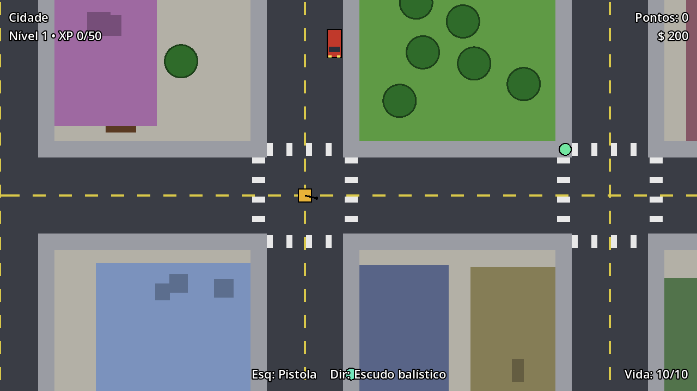
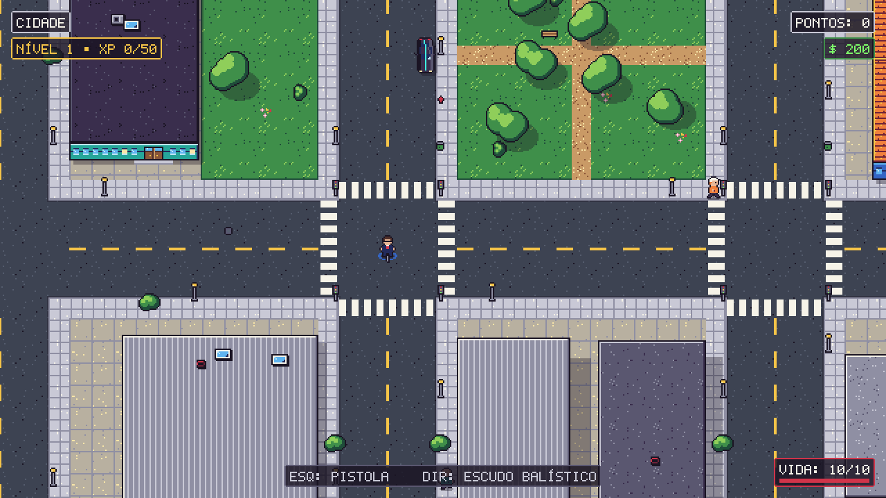
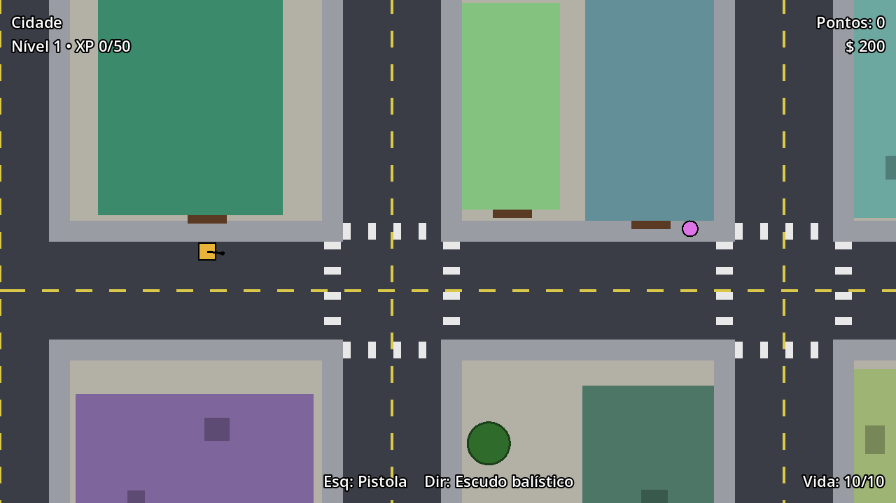
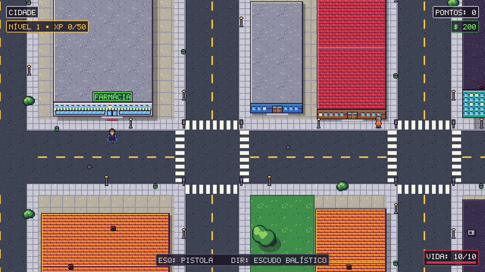
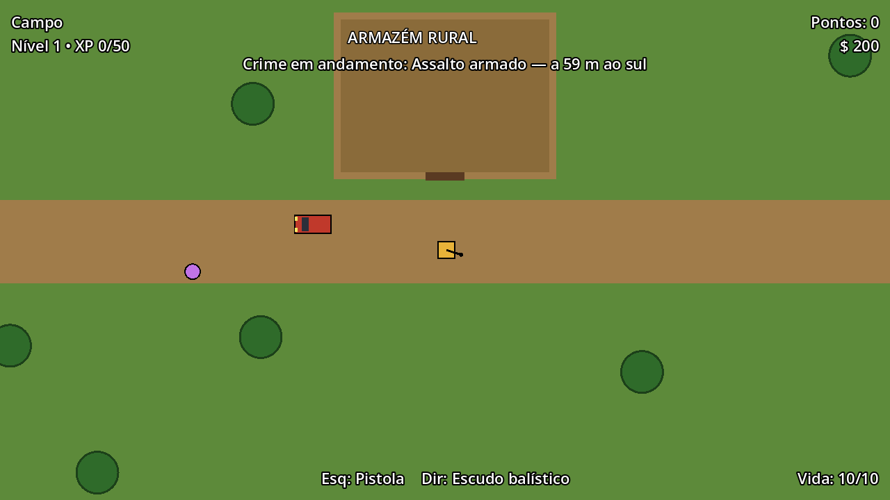
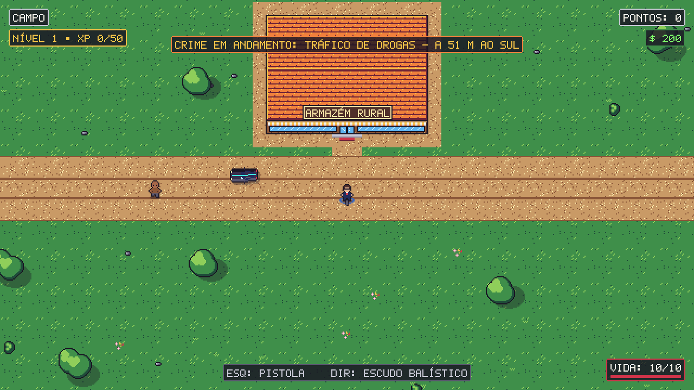

# Redesenho — Fase 1: base visual do mundo externo

> Implementação da Fase 1 do [roteiro](redesign-roteiro.md), seguindo o
> [design aprovado](redesign-visual.md). Decisões em vigor: anos 80 (D1) e viewport
> 1280x720 com pixel lógico de 2 px (D2).

## Antes e depois

| Antes | Depois |
|---|---|
|  |  |
|  |  |
|  |  |

Outras capturas: [parque](img/fase1-parque.png), [borda cidade/campo](img/fase1-borda.png),
[plantação](img/fase1-plantacao.png), [interior](img/fase1-interior.png),
[folha de sprites](img/fase1-sprites.png).

## O que entrou

### Fábrica de arte (`scripts/art/`)

Toda a arte é gerada por código, uma única vez, e guardada em cache. Nenhum arquivo de imagem.

| Arquivo | Papel |
|---|---|
| `palette.gd` | 32 cores, rampas por material, tons de lataria/roupa, legenda letra → cor |
| `pixel_canvas.gd` | Tela de pixel art sobre `Image`: sprite a partir de texto, contorno, espelho, rotação, tile repetido |
| `pixel_font.gd` | Fonte 5x7 própria com acentos do português (só maiúsculas) |
| `tile_factory.gd` | Tiles de 32x32 texels: asfalto, calçada, lote, grama, terra, plantações, água, telhados, paredes, pisos, marcações de rua |
| `character_sprites.gd` | Personagens 12x16 em 4 direções e 3 quadros; aparência por seed |
| `car_sprites.gd` | 7 modelos de carro, 10 cores, 32 direções pré-geradas |
| `prop_sprites.gd` | Mobiliário urbano, árvores, detalhes de telhado, itens, projéteis, cercas |
| `building_art.gd` | Um prédio inteiro em uma textura: telhado, fachada, janelas, porta, toldo, letreiro |
| `sprite_factory.gd` | Cache de `ImageTexture` por chave; cria `Sprite2D` já na escala do texel |

### Mundo

- **Chão em pedaços:** `ground_chunk.gd`, um nó por 560x560 px (288 no mundo). Desenha calçada com
  meio-fio, lote, parque, quintais, faixa central, faixas de pedestres, sombras dos prédios e objetos.
  O motor descarta os pedaços fora da tela. A base (asfalto e grama) são dois retângulos de tile repetido.
- **Prédios:** telhado de laje, piche, zinco ou telha (3 cores), fachada sul com 1 a 5 andares de
  janelas, porta, degrau, e nas lojas vitrine, toldo listrado e letreiro. Estilo por
  `building_style.gd`, determinístico pelo id (na Fase 2 passa a vir do bairro e do tipo).
- **Mobiliário urbano:** `street_props_layout.gd` (lógica pura, por seed). Postes, semáforos, hidrantes,
  lixeiras, pontos de ônibus, bancas, árvores de calçada e bueiros. Nada na calçada é sólido e tudo
  fica junto ao meio-fio, fora da linha dos pedestres e longe das portas.
- **Parques:** caminhos de terra em cruz, lago em parte deles, bancos, canteiros e arbustos.
  Quintais gramados com arbustos e flores (`CityLayout.yards`, campo novo).
- **Campo:** grama com tufos, pedras e flores, plantações de dois tipos com cerca, estrada de terra com
  marcas de roda, terreiro e caminho de terra em cada fazenda, celeiros de madeira com telhado de telha.
- **Camadas (z):** chão 0 · itens 1 · prédios 2 · personagens e carros 3 · projéteis 4 · copas, postes
  e coberturas 5.

### Personagens, carros e itens

- Jogador: terno, gravata e óculos escuros, com anel no chão (J1 azul, J2 laranja). O corpo olha para a
  direção dominante da mira; a arma (ou um retículo, sem arma) acompanha o ângulo exato.
- Civis: roupa, cabelo, corte e pele por seed da identidade. Criminosos: gorro, máscara e camisa listrada.
- Animação de andar com 2 quadros de passo; NPC atordoado fica azulado.
- Carros da agência (os que o jogador dirige) são o esportivo preto com faixa ciano. O trânsito usa
  sedã, hatch, picape, van e táxi em cores variadas. `car.color` deu lugar a `car.model` e `car.tone`.
- Itens no chão e projéteis usam sprites (dinheiro, kit médico, pistola, escopeta, taser, escudo).

### HUD e painéis

- HUD em placas com borda e fonte pixel (`pixel_label.gd`); barra de vida sob o texto.
- Espaços novos, ocultos enquanto vazios: `set_place` (bairro e rua, Fase 2) e `set_clock` (Fase 4).
- Inventário, ficha, loja e card de conversa receberam a moldura retrô (`ui_style.gd`); a fonte deles
  continua a padrão até a Fase 5.
- Interior: piso, móveis e paredes da fábrica de arte, em caráter provisório. Os interiores por tipo
  são a Fase 3.

## Desempenho

Medido com `tools/probe.gd` (vsync desligado, 1280x720, 6 pontos fixos, 4 s cada), na máquina do autor.

| | Antes | Depois |
|---|---|---|
| Tempo médio de quadro | 6,5 ms | 1,9 a 2,5 ms (três medições) |
| Chamadas de desenho por quadro | 928 a 941 | 132 a 175 |
| Nós na cena | 3034 a 3038 | 3299 a 3309 |

A queda vem de trocar centenas de `ColorRect` por uma textura por prédio e de o chão passar a ser
descartado fora da tela. Não foi medido no export web.

## Ferramentas (`tools/`)

```bash
# Abre o jogo, salva capturas em docs/img/<prefixo>-*.png e mede o desempenho
Godot_v4.7.2-stable_win64_console.exe --path . -s tools/probe.gd -- fase1

# Folha com todos os sprites e tiles, ampliada 4x
Godot_v4.7.2-stable_win64_console.exe --headless --path . -s tools/sprite_sheet.gd -- res://docs/img/fase1-sprites.png
```

`docs/img/.gdignore` impede o Godot de importar as capturas como recurso do jogo.

## Testes

Suíte: **487 testes, 0 falhas** (eram 385). Nenhum teste existente precisou ser alterado.

| Arquivo novo | Cobre |
|---|---|
| `test_palette_and_canvas.gd` | 32 cores únicas, rampas, legenda; operações da tela de pixel |
| `test_pixel_font.gd` | Formato das letras, acentos, cobertura dos textos do jogo, medidas |
| `test_sprites.gd` | Personagens, carros, objetos e tiles: tamanhos, só cores da paleta, variações, cache |
| `test_building_art.gd` | Estilo determinístico, limite da fachada, lojas com letreiro, desenho sem buracos |
| `test_street_props.gd` | Determinismo, nada sólido, fora da linha de caminhada e das portas, parques e quintais |
| `test_world_visuals.gd` | Cena real: pedaços de chão, sem `ColorRect`, sprites de jogador/NPC/carro, ordem de desenho, HUD |

## O que ficou de fora desta fase

- **Avenidas mais largas (item 1.2):** dependem da decisão D6 e mexem em calçadas e trânsito; passam
  para a Fase 2, como previsto no design.
- **Relógio, bairro e rua no HUD (item 1.13):** os espaços existem, mas ficam vazios até as Fases 2 e 4.
- **Ajuste de janela para escala inteira e `snap_2d_transforms_to_pixel`:** citados no design como
  mitigação da opção A; não foram feitos. Em janelas de escala não inteira alguns texels podem ficar
  com 1 px de diferença.
- **Semáforos** são fixos (não trocam de cor) e os **bancos de praça** não são sólidos.
- A borda entre cidade e campo é uma linha reta de asfalto para grama, sem transição.

## Observação

O log dos testes mostra duas vezes o erro `Can't change this state while flushing queries`, vindo de
`pickup.gd` quando um criminoso morre por tiro e larga o loot. Já acontecia antes desta fase (o item é
criado dentro de um retorno da física) e não causa falha; fica registrado para correção futura.
