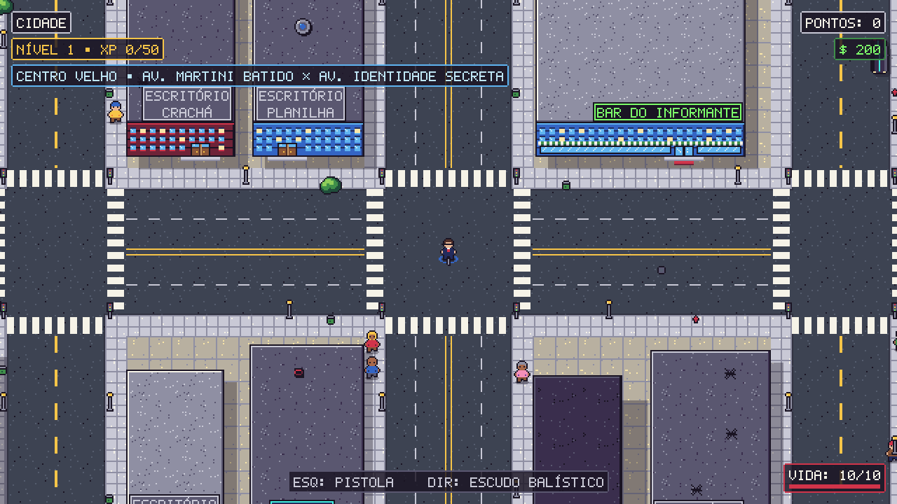
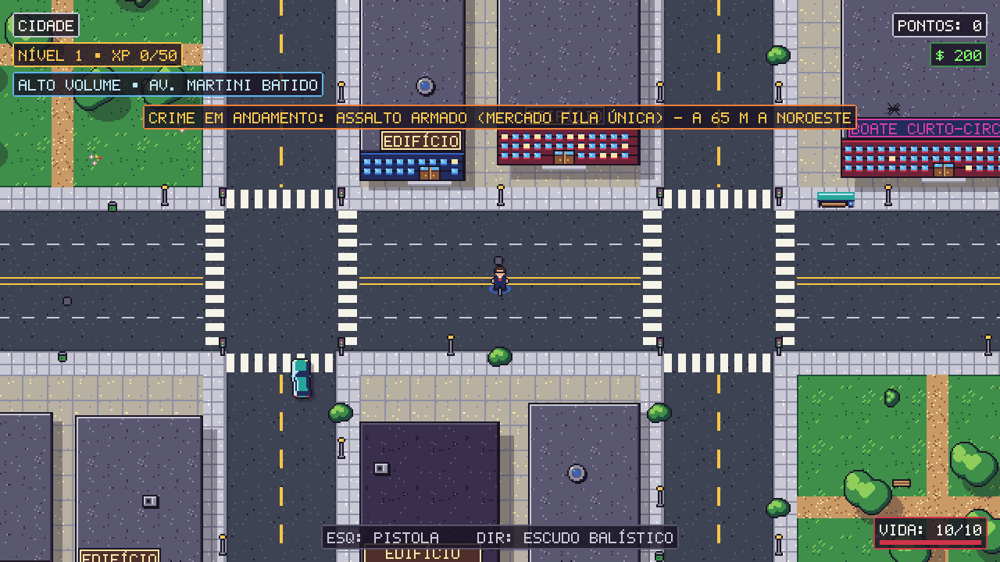
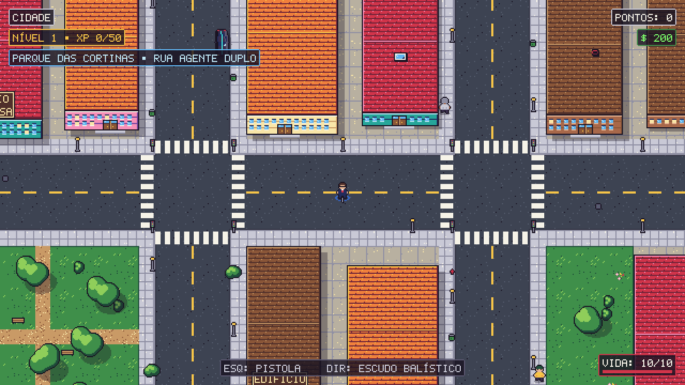
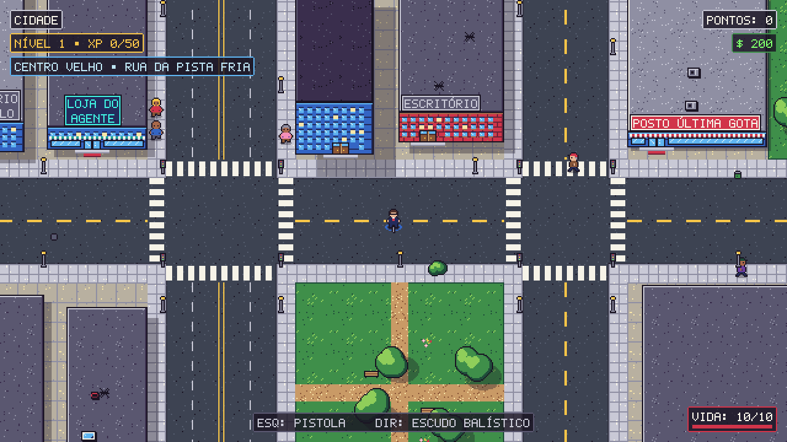
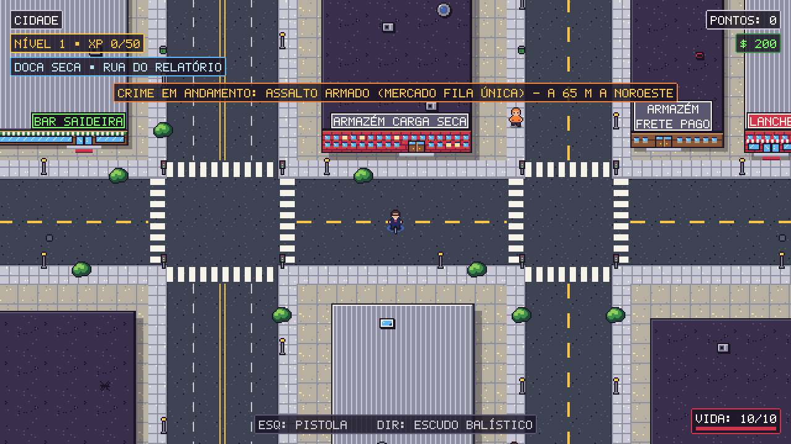
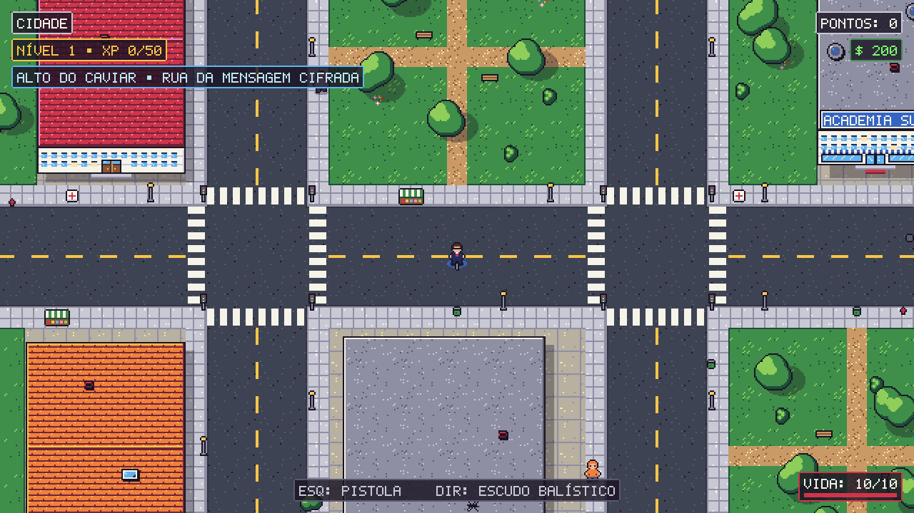

# Redesenho — Fase 2: cidade com contexto

> Itens 2.1 a 2.11 do [redesign-roteiro.md](redesign-roteiro.md), mais a avenida adiada da Fase 1 (1.2),
> o bairro e a rua no HUD (1.13) e os itens 1.1 e 1.3 da etapa E1 do [roteiro-jogo.md](roteiro-jogo.md).
> Design: seção 5 do [redesign-visual.md](redesign-visual.md).

## Capturas

| Avenidas (cruzamento central) | Vida noturna | Residencial |
|---|---|---|
|  |  |  |

| Centro | Industrial | Bairro nobre |
|---|---|---|
|  |  |  |

## O que entrou

### Avenidas (`city_layout.gd`, `sidewalk_graph.gd`, `traffic_route.gd`, `ground_chunk.gd`)

- As linhas 6 (vertical e horizontal) são avenidas: asfalto de 180 px (rua comum: 140), corredor de 240 px.
  A horizontal continua na estrada do campo.
- Os lotes vizinhos de uma avenida têm 340 px no eixo que encosta nela (`CityLayout.lot_rect(cx, cy)`).
- Largura por linha: `CityLayout.asphalt(linha)`, `corridor(linha)`, `is_avenue(linha)`;
  `SidewalkGraph.half(linha)`.
- Trânsito: duas faixas por sentido na avenida (28 e 66 px do eixo); cada carro usa uma (`car.ai_lane`).
- Chão: duas linhas contínuas no eixo, divisórias tracejadas entre as faixas, faixas de pedestre mais longas.
- Nenhum carro da agência fica estacionado em avenida.

### Bairros (`district_layout.gd`)

Seis bairros por seed. O Centro nasce nas 4 quadras do meio; os outros cinco partem de pontos em setores
ao redor e crescem quarteirão a quarteirão (sempre por um vizinho, então são contíguos) até a cota.
Se algum ficar com menos de 10 quadras, a geração repete com a seed derivada seguinte.

| Bairro | Seed 2024 | Quadras | Andares | Telhado | Formato dos lotes |
|---|---|---|---|---|---|
| Centro comercial | Centro Velho | 27 | 3 a 6 | laje | prédio único ou dois |
| Residencial | Parque das Cortinas | 40 | 1 a 2 | telha | com quintal, 15% de parques |
| Vida noturna | Alto Volume | 20 | 2 a 3 | laje | dois prédios |
| Industrial | Doca Seca | 24 | 1 a 2 | zinco | prédio único, sem parques |
| Bairro nobre | Alto do Caviar | 22 | 1 a 3 | telha | com quintal, 20% de parques |
| Cívico | Largo do Protocolo | 11 | 2 a 4 | laje | prédio único |

Cada bairro tem paleta de paredes própria (9 tons novos em `Palette.TONES`, todos das 32 cores).

### Tipos de prédio (`building_defs.gd`)

Tabela única com 24 tipos (21 urbanos, a redação do jornal pedida pela campanha e 2 rurais). Por tipo:
nome, bairros, mínimo e máximo, tamanho mínimo, vitrine, toldo, cores do letreiro, funcionários, horário,
serviço e loja. `SHOP_PLAN` saiu do `CityLayout`; as lojas viraram entradas da tabela com o mesmo estoque.

Atribuição: (1) cada tipo com mínimo escolhe seus prédios, na ordem da tabela, entre os que cabem e estão
em bairro permitido; (2) sorteiam-se os extras até o máximo; (3) o resto é preenchido por peso do bairro
(escritório, prédio residencial, casa, armazém).

Seed 2024: 185 prédios, 47 com serviço. Os tipos que a campanha exige (QG, banco, boate, delegacia,
oficina, bar, jornal) existem em qualquer seed (`BuildingDefs.STORY_TYPES`, testado em 13 seeds).

O horário de funcionamento (`BuildingDefs.is_open`) e o multiplicador de noite dos crimes já estão nos
dados e testados, mas só passam a valer com o relógio da Fase 4. Os serviços entram na Fase 3.

### Nomes (`name_generator.gd`)

- Prédios: nome próprio por seed, sem repetir ("Bar Sem Testemunhas", "Banco Confia em Mim",
  "Lavanderia Sigilo" para o QG). Aparece no letreiro e na instrução da porta
  ("Pressione E para entrar no Hotel Álibi").
- Letreiro que não cabe na largura do prédio usa o texto curto do tipo ("EDIFÍCIO") ou some.
- 26 linhas de rua com nome; as duas avenidas são "Av. ...". O HUD mostra "bairro • rua"
  (nos cruzamentos, as duas ruas; no campo, "Estrada do Contrabando" perto da estrada).

### NPCs ligados ao mundo (`npc/population.gd`, `npc_identity.gd`)

Cada civil recebe um prédio real onde trabalha (tipos com funcionários) e outro onde mora (casa, prédio
residencial ou fazenda), na região onde está. As respostas citam os lugares:

- "Sou conferente no Armazém Guindaste II há 15 anos."
- "Me chamo Quitéria Costa, tenho 37 anos e moro na Casa 973, no Parque das Cortinas, há 8 anos."

Sem contexto (NPC avulso, testes antigos) valem as falas e a lista `JOBS` de antes.

### Crimes por bairro e por prédio (`crime_profiles.gd`, `incident_manager.gd`)

- Cada tipo de crime da cidade tem `near` (tipos de prédio), `districts` (multiplicador por bairro) e
  `night` (multiplicador à noite).
- Três tipos novos: assalto a banco, briga de bar e arrombamento. Os seis antigos não mudaram.
- O crime acontece em frente a um prédio compatível a até 1500 px do jogador, e o aviso cita o prédio:
  "Crime em andamento: Briga de bar (Boate Curto-Circuito) — a 48 m ao leste". Sem prédio compatível
  (ou no campo), vale o ponto livre de antes.

### Outros

- `GameState` guarda `building_type` e `building_name`; no interior, o HUD mostra o nome do prédio.
- O aviso do topo do HUD desceu para baixo da linha do lugar (o texto ficou mais longo).
- `tools/probe.gd` captura também o cruzamento das avenidas e uma rua de cada bairro.
- `tests/run_tests.gd` aceita filtro: `-- combat traffic` roda só os arquivos com esses termos.

## Desempenho

Medido com `tools/probe.gd` (vsync desligado), nos 6 pontos que já existiam:

| | Antes (commit inicial) | Depois |
|---|---|---|
| Tempo de quadro médio | 1,73 ms | 1,81 ms (+5%) |
| Chamadas de desenho | 132 a 175 | 135 a 206 |
| Nós | ~3300 | ~3330 |

Nos 13 pontos atuais a média ficou entre 1,89 e 1,99 ms em duas execuções. Dentro da meta (até 20%).

## Testes

577 testes, 0 falhas (eram 487). Arquivos novos: `test_districts.gd`, `test_building_defs.gd`,
`test_names.gd`, `test_population.gd`; acréscimos em `test_crime`, `test_traffic`, `test_sidewalks`,
`test_city_layout`, `test_building_art`, `test_scenes`, `test_game_state` e `test_combat`.

Testes existentes alterados por mudança intencional:

| Teste | Motivo |
|---|---|
| `test_city_layout`: tamanho do lote | Largura deixou de ser única (lotes de avenida têm 340 px) |
| `test_city_layout`: lojas atribuídas | `SHOP_PLAN` saiu; a cota vem de `BuildingDefs` |
| `test_city_layout`: seed diferente | Comparava `color`, que agora vem de uma paleta pequena; compara o retângulo |
| `test_sidewalks`: comprimento do trecho | Depende da largura das ruas cruzadas |
| `test_building_art`: letreiro só em loja | Todo prédio com tipo tem letreiro (menos casas) |
| `test_building_art`: letreiro cabe | Vale para todos os prédios, com o texto reserva |
| `test_crime`: distância do crime | O prédio compatível pode estar a até 1500 px |

## O que ficou de fora

- Item 1.2 da etapa E1 (fazenda de ensaio e silo no campo): fica com os interiores de história.
- Cercas e celeiros do campo como dados (seção 6 do design): o campo só ganhou tipo e nome nas fazendas.
- Prefeitura como fachada especial de um escritório do bairro cívico.
- Posto e mercado ainda não vendem nada: dependem do item de comida (decisão D7, antes da Fase 3).
