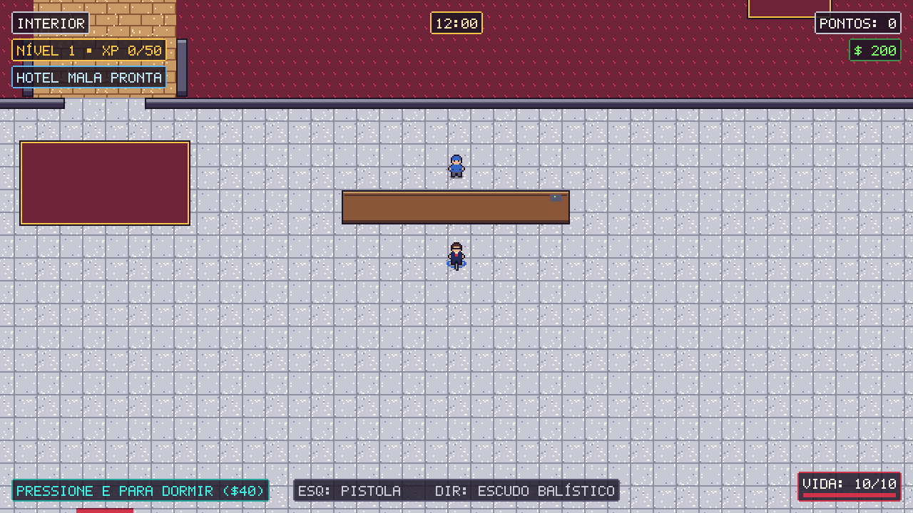
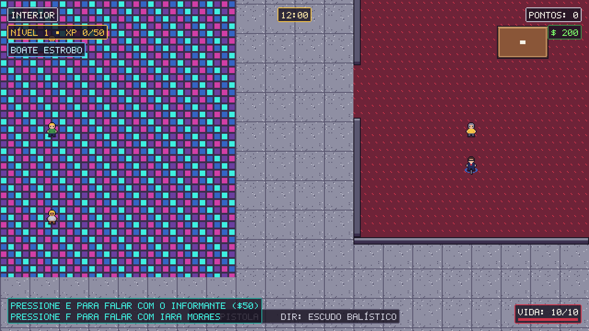
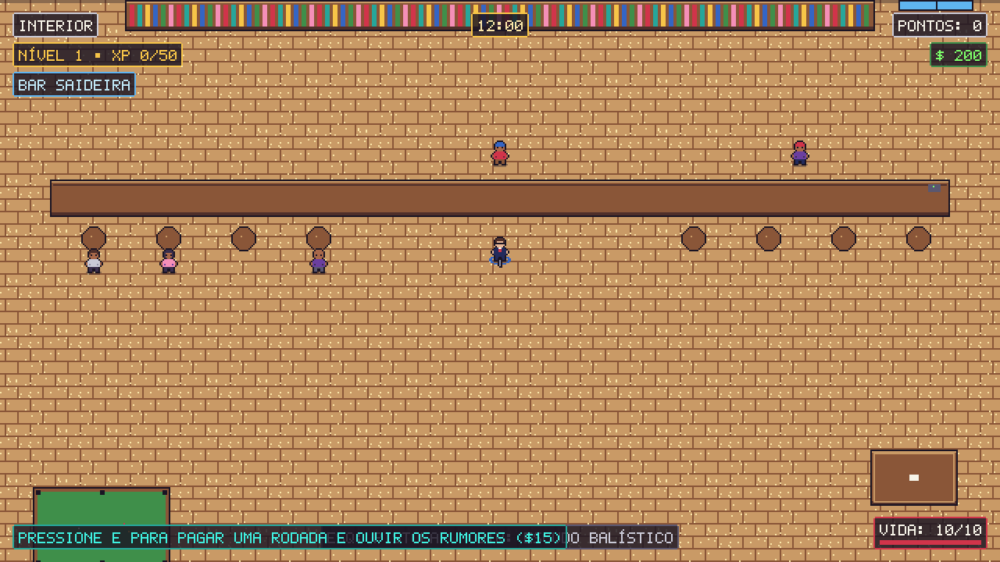
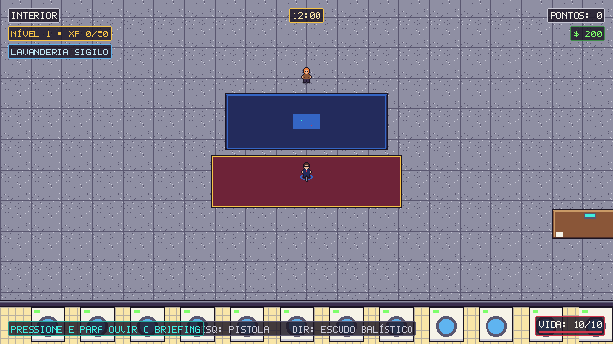
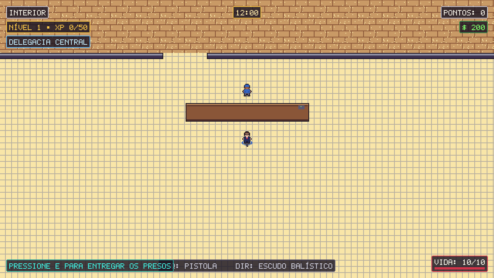
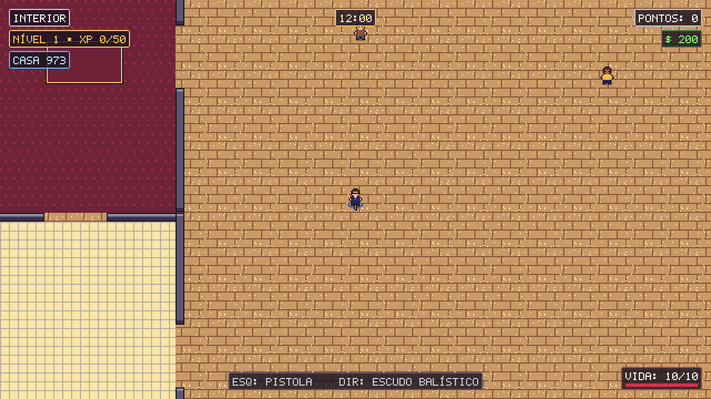

# Redesenho — Fase 3: interiores com finalidade

> Itens 3.1 a 3.9 do [redesign-roteiro.md](redesign-roteiro.md). Design: seção 7 do
> [redesign-visual.md](redesign-visual.md). Capturas em `docs/img/fase3-interior-*.png`.

## Capturas

| Hotel (balcão e serviço) | Boate (pista e camarote) | Bar (balcão, banquetas, sinuca) |
|---|---|---|
|  |  |  |

| QG (sala de briefing) | Delegacia | Casa |
|---|---|---|
|  |  |  |

Há uma captura de cada um dos 15 modelos (`fase3-interior-<tipo>.png`).

## O que entrou

### Interior paramétrico (`interior/interior_layout.gd`)

`InteriorLayout.new(id_do_prédio, tipo, largura_da_fachada)`. A seed é o id do prédio. Gera:

- **Tamanho:** três classes, P (1280x800), M (1920x1200, o de antes) e G (2560x1440). O modelo define a base;
  fachada com menos de 180 px desce um degrau e com 280 px ou mais sobe um (`size_class_for`).
- **Cômodos** com piso próprio, **paredes internas** com vãos de porta, **móveis** (sólidos ou só desenho no chão),
  **vagas de NPC** com papel e **zonas de serviço**.
- **Variação por seed:** espelhamento horizontal e a quantidade de quartos, mesas, prateleiras, clientes.
- **Validação (V5):** `unreachable()` faz um preenchimento em grade de 32 px, com a colisão do jogador, a partir
  da entrada e confere se a saída e todas as zonas são alcançáveis. Os testes percorrem os 24 tipos, 20 ids cada
  e os tamanhos extremos de fachada.

15 modelos (24 tipos de prédio usam um deles):

| Modelo | Usado por | Base | Planta e móveis reconhecíveis |
|---|---|---|---|
| Loja | armaria, farmácia, loja do agente, mercado, posto, armazém rural | P | Depósito ao fundo, balcão, prateleiras em fileiras |
| Hotel | hotel | G | Saguão, corredor, 4 a 6 quartos com cama e criado-mudo |
| Restaurante | restaurante, lanchonete (menor) | M | Cozinha com fogão e geladeira, balcão, mesas |
| Bar | bar | M | Balcão comprido com banquetas, mesas, sinuca, jukebox |
| Boate | boate | G | Pista de luzes, cabine do DJ, caixas de som, bar, camarote fechado com o informante |
| Banco | banco | M | Guichês, fila de cordão, cofre ao fundo |
| Delegacia | delegacia | G | Recepção, sala dos agentes, celas com grade e beliches |
| Hospital | hospital | G | Recepção, enfermaria com macas e biombos, consultório |
| Oficina | oficina | M | Elevador com carro, bancada, pneus, ferramentas |
| Cinema | cinema | G | Bilheteria, pipoca, sala com poltronas e tela |
| Academia | academia | M | Ringue, esteiras, halteres, vestiário |
| Escritório | escritório, redação do jornal | M | Recepção, baias, sala do chefe |
| Moradia | casa, prédio residencial, fazenda | P | Sala, cozinha, quarto |
| Armazém | armazém | G | Pilhas de caixas, paletes, empilhadeira |
| QG | QG | G | Lavanderia na frente; sala secreta atrás de uma máquina de lavar |

### Arte (`art/furniture_art.gd`, `art/tile_factory.gd`)

Cada móvel é desenhado por código no tamanho pedido, em cache por tipo e tamanho (62 tipos de móvel). Pisos novos:
carpete, xadrez, concreto, pista de dança e mármore. Só cores da paleta, contorno tinta, luz do noroeste.

### Serviços (`interior/services.gd`)

Lógica pura no formato do `ShopDefs.buy`: devolve `{result, message}`. Toda interação passa por uma
`InteractZone` e pela ação `p{N}_interact`, com o verbo e o preço no HUD ("Pressione E para dormir ($40)").

| Prédio | Serviço | Custo | Efeito |
|---|---|---|---|
| Hotel | Dormir | $40 | Vida cheia; relógio vai para 07:00 (dia seguinte se for de noite) |
| Restaurante | Refeição | $25 | +6 de vida |
| Lanchonete | Lanche | $10 | +3 de vida |
| Hospital | Atendimento | $5 por ponto que falta | Vida cheia |
| Delegacia | Entregar presos | — | Cada preso rende +40 pontos e $30 |
| Banco | Depositar e sacar | — | $100 por vez; o dinheiro do banco não se perde ao ser derrotado |
| Bar | Rodada e rumores | $15 | Sorteia um crime futuro em um prédio compatível; a seta do HUD mostra o caminho |
| Boate | Informante | $50 | Marca os criminosos por perto (até 4, raio de 1800 px) por 60 s |
| QG | Briefing | — | Estado do dia e uma missão por dia (a mesma mecânica da pista) |
| Oficina | Pintar o carro | $30 | Troca a cor dos carros da agência (6 cores) |
| Cinema | Sessão | $20 | Avança 2 h; +25% de XP por 5 min |
| Academia | Treino | $30 | +20 de XP, uma vez por dia |
| Mercado, posto | Loja | preço da tabela (posto +50%) | Vendem o item novo `snack` e kit médico |
| Lojas atuais | Comprar e vender | como antes | Como antes |

### NPCs dentro dos prédios

Cada vaga cria um NPC parado (`npc.stationary`) com papel: funcionários com o papel do tipo de prédio
("bartender", "caixa", "DJ", "informante"), clientes e moradores. A conversa cita o lugar
("Sou bartender no Bar Saideira há 5 anos").

### Decisão D7 (mecânicas novas)

Assumi **sim para as quatro** (ver `redesign-visual.md`, seção 12). Se quiser outra resposta, cada uma é isolada:

| Mecânica | Como ficou |
|---|---|
| Perder dinheiro ao ser derrotado | Perde metade do que carrega; o do banco fica; acorda em frente ao hospital mais próximo (`World._on_player_died`) |
| Presos a entregar | Atordoar um criminoso soma 1 em `profile.prisoners` (uma vez por criminoso); a delegacia paga |
| Item de comida | `snack` (cura 3, até 5, $12) em `item_defs.gd` |
| Seta de alvo no HUD | `Hud.set_targets`; aponta a pista (rumor ou briefing) e os criminosos revelados |

A vida passou a ser guardada na ficha entre as trocas de cena: entrar em um prédio não cura mais.

### Pistas de crime

`CrimeProfiles.make_tip` sorteia um tipo de crime e um prédio compatível. Ao voltar para a rua, o mundo cria o crime
no lugar indicado depois de 4 s; a pista só some quando o crime é resolvido.

## Testes

Arquivos novos: `test_services.gd`; `test_interior_layout.gd` foi reescrito para o modelo paramétrico.
Acréscimos em `test_scenes`, `test_hud`, `test_pickups_and_shops`.

| Teste atualizado | Motivo |
|---|---|
| `test_interior_layout` (8 testes) | Sala única de 1920x1200 virou interior por tipo; `SIZE`, `COUNTER` e funções estáticas viraram de instância |
| `test_pickups_and_shops` (interior de loja) | Loja agora usa o modelo "loja"; balcão e zona vêm da instância |
| `test_scenes` (3) | Posição de entrada e saída vêm do layout da instância |
| `test_building_art`, `test_city_layout`, `test_world_layout` (lojas) | Mercado e posto passaram a vender: 5 tipos de loja na cidade |
| `test_world_visuals` (HUD) | O relógio do mundo aparece desde a Fase 4 |

## O que ficou de fora

- O baú do QG é só visual (guardar e retirar itens depende do inventário de 16 espaços, etapa E4).
- A oficina só pinta; o conserto espera o dano de veículos.
- Jukebox, sinuca, cabine do DJ etc. são cenário; a única interação deles é visual.
