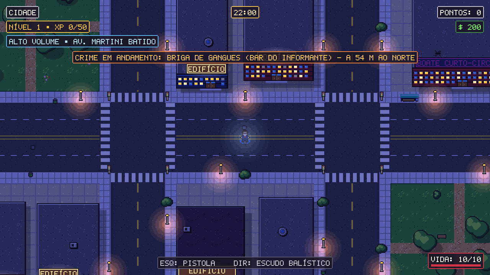
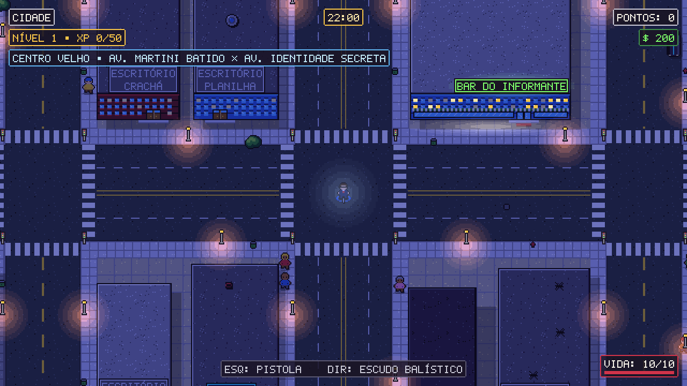

# Redesenho — Fase 4: dia e noite

> Itens 4.1 a 4.19 do [redesign-roteiro.md](redesign-roteiro.md). Design: seção 8 do
> [redesign-visual.md](redesign-visual.md). Capturas em `docs/img/fase4-noite-*.png`
> (tire as suas com `tools/probe.gd -- <prefixo> <hora>`).

## Capturas

| Vida noturna, 22:00 | Avenidas, 22:00 |
|---|---|
|  |  |

## O que entrou

### Relógio (`world/day_cycle.gd`, `autoload/world_clock.gd`)

- `DayCycle`: lógica pura. Um dia dura 12 min reais (1 h de jogo = 30 s), começando às 08:00. Fases: madrugada 00 a 05,
  amanhecer 05 a 08, dia 08 a 17, entardecer 17 a 19:30, noite 19:30 a 24.
- `WorldClock` (autoload): só acumula o tempo (`seconds`) e emite `hour_changed` e `phase_changed`. O estado inteiro
  é um número, então o anfitrião pode enviá-lo no multiplayer. `set_hour`, `advance_hours`, `advance_to` e `reset`.
  O runner de testes zera o relógio a cada teste.
- A hora aparece no HUD, no topo ao centro.

### Cor ambiente (V9)

Um `CanvasModulate` no mundo externo interpola entre chaves: azul-violeta de madrugada, rosa às 06:15, branco de dia,
laranja às 18:30, roxo às 19:30. **Piso de luminosidade:** nunca abaixo de 0,45 de luminância nem de 0,40 em qualquer
canal; o teste percorre o dia inteiro minuto a minuto e também confere que a cor muda sem saltos.

### Luzes (V10)

As luzes ficam em uma `CanvasLayer` própria (`world/light_layer.gd`) que acompanha a câmera e não é tingida. Brilho
aditivo, sem nenhuma `Light2D` (a medição abaixo mostra que a abordagem aguenta). Um par de nós por quarteirão
(`world/light_chunk.gd`): um redesenha sem escurecer o que brilha, outro soma brilho ao chão.

| Luz | Acende | Apaga |
|---|---|---|
| Poste (poça laranja de 96 px) e semáforo | 18:00 | 06:30 |
| Janelas (40% a 70% acesas, padrão pela seed) | 18:00 | Moradias às 23:00, escritórios às 20:00, o resto às 06:00 |
| Letreiro e halo | 18:00, se o prédio está aberto | Ao fechar; o da boate pisca |
| Vitrine (faixa de luz na calçada) | À noite, com a loja aberta | Ao fechar |
| Faróis e lanternas dos carros em movimento | 18:00 | 06:30 |
| Halo do jogador | 19:30 | 06:00 |

Os prédios expõem `window_cells`, `lit_window_cells`, `window_lights` e `sign_canvas` para a camada de luz
desenhar só as janelas e o letreiro, sem redesenhar o prédio.

### Interiores

Não têm `CanvasModulate`: ficam sempre claros. As janelas da parede norte mostram o céu da hora atual (`sky_color`).

### Efeito no mundo

| Sistema | De dia | À noite |
|---|---|---|
| Portas | Abrem conforme a tabela de tipos | Fechado: a instrução vira "Fechado — abre às HH:00" e o E não abre |
| Pedestres da cidade | 110 | 60 até 23:00; 25 de madrugada. O excesso vai para casa: segue o passeio e some em uma porta de moradia |
| Trânsito | 10 carros | 6; os que saem só somem longe da vista do jogador, e voltam de manhã também longe |
| Crimes | Pesos normais | Pesos pelo multiplicador `night` de cada crime; intervalo na cidade 36% menor; assalto a banco só com o banco aberto |

## Desempenho

Medido com `tools/probe.gd` (vsync desligado), média dos 6 pontos que já existiam:

| | Antes da Fase 2 | Fim da Fase 2 | Fim das Fases 3 e 4, 12:00 | Fim das Fases 3 e 4, 22:00 |
|---|---|---|---|---|
| Tempo de quadro | 1,73 ms | 1,81 ms | 1,89 ms (+9%) | 2,19 ms (+27%) |
| Chamadas de desenho | 132 a 175 | 135 a 206 | 137 a 207 | 138 a 232 |

**Atenção:** de noite o tempo de quadro passa da meta de 20% sobre a linha de base (+27% nos pontos da cidade). Em
valor absoluto são 2,3 ms (cerca de 430 fps) nesta máquina, então não é um problema hoje, mas o export web precisa ser
medido (fim da fase, T7). Se pesar, o primeiro candidato é reduzir os nós de brilho: hoje são 288 por quarteirão
(emissivo e brilho), todos descartados fora da tela.

## Testes

Arquivos novos: `test_day_cycle.gd` (relógio, fases, horários, cor ambiente, luzes) e `test_lights.gd` (arte das luzes,
camada de luz, faróis, interiores, portas fechadas, população). Acréscimos em `test_crime.gd`.
684 testes, 0 falhas (eram 577 no fim da Fase 2).

## O que ficou de fora

- `Light2D`: não foi necessária.
- NPCs indo para casa só somem na porta; não existe cena de entrada.
- O relógio é por jogador no HUD, mas único no mundo; em co-op local futuro o anfitrião vale para todos.
