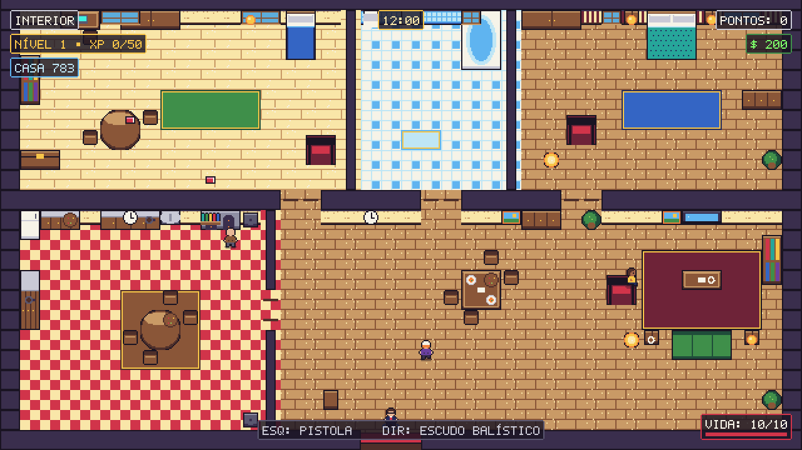
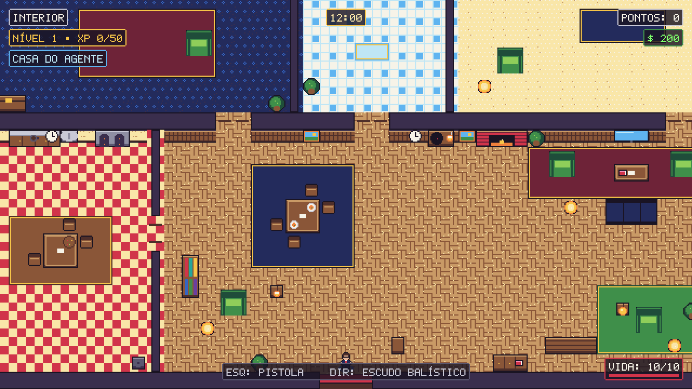
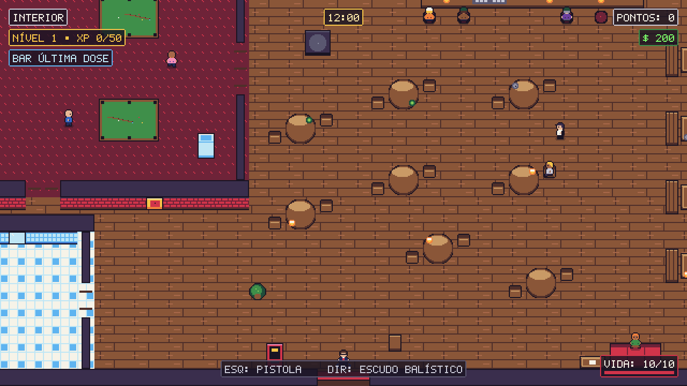
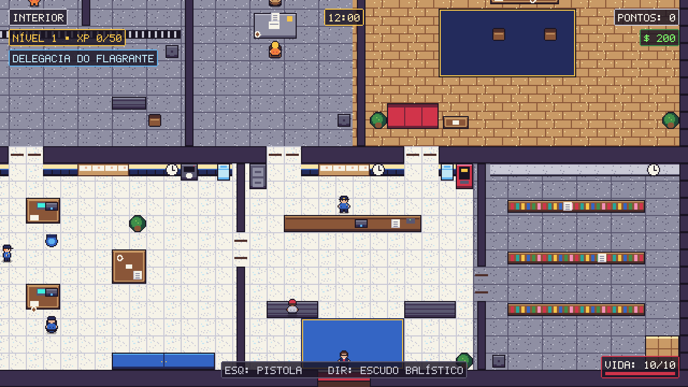
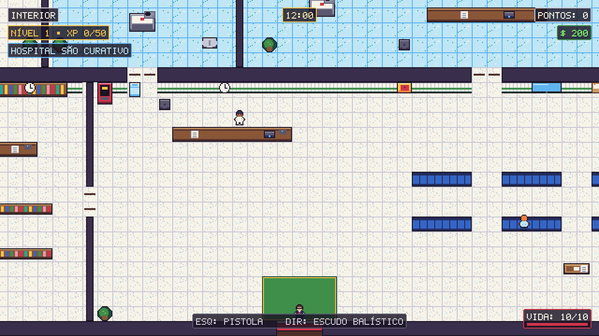
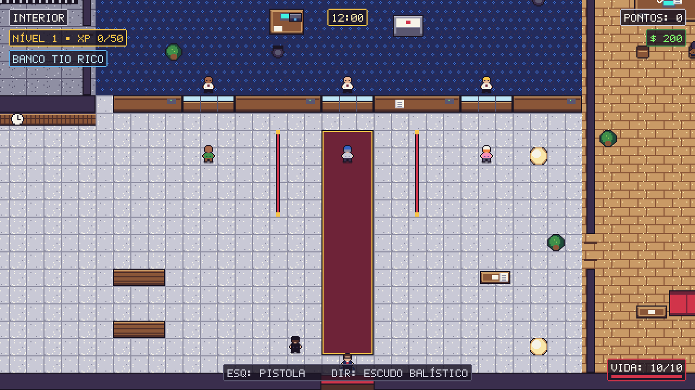
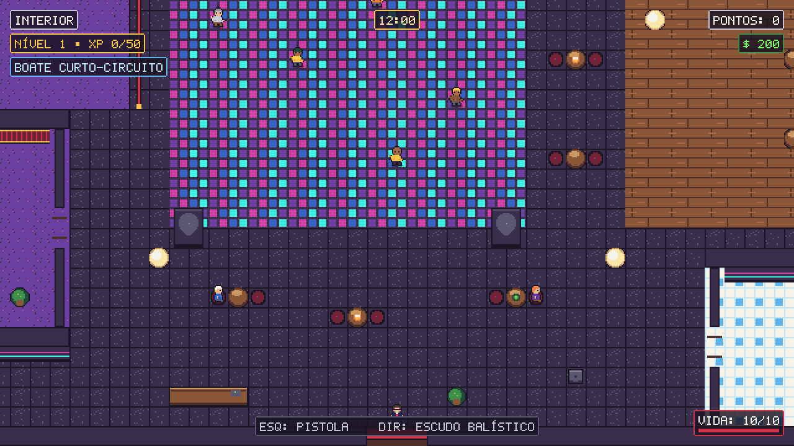
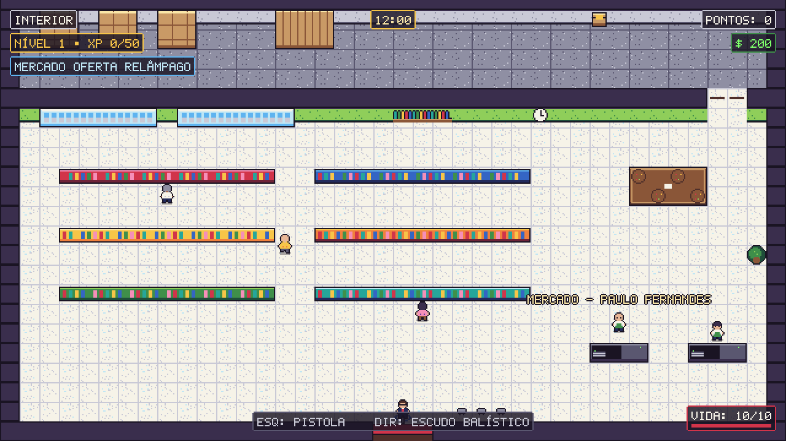
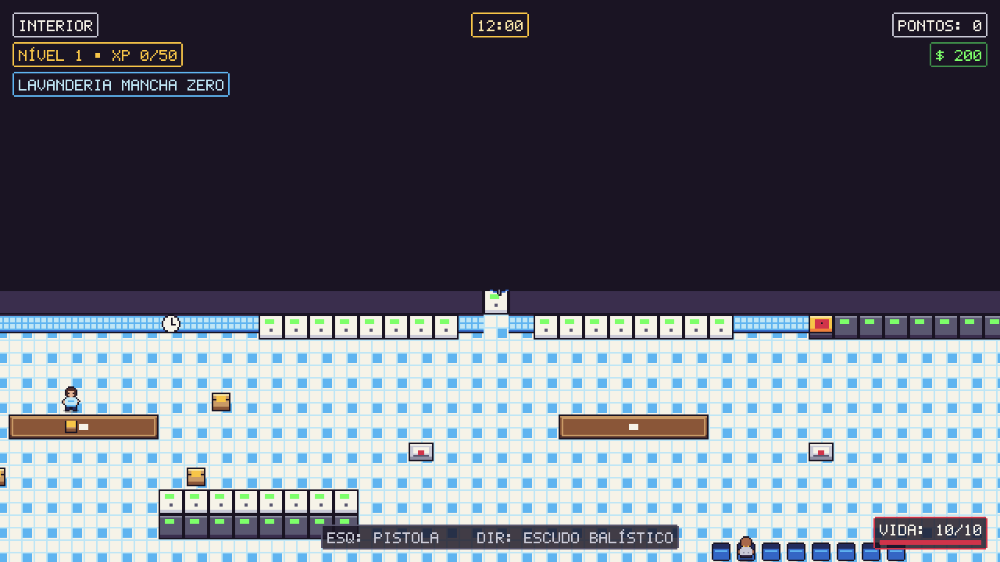

# Fase 7 — Interiores caprichados (Etapas 1 e 2: todos os 25 interiores em planta)

> Design: [superpowers/specs/2026-11-15-interiores-caprichados-design.md](superpowers/specs/2026-11-15-interiores-caprichados-design.md).
> Plano: [superpowers/plans/2026-11-15-interiores-caprichados-etapa-1.md](superpowers/plans/2026-11-15-interiores-caprichados-etapa-1.md).
> Capturas em `docs/img/fase7-interior-*.png`.

## Por quê

Os interiores eram salões de 1280x800 a 2560x1440 px (até 4 telas), com poucos móveis desenhados 2 a 3 vezes
maiores que o personagem e decoração sorteada (vasos e lixeiras). Pareciam vazios e genéricos. Agora cada tipo
tem uma **planta autoral**, do tamanho da tela ou pouco maior, com móveis na escala do personagem, piso e
paredes com cara do lugar e gente que faz alguma coisa.

## Capturas

Há uma captura de cada um dos 25 interiores em `docs/img/fase7-interior-<tipo>.png`. Algumas:

| Casa | Casa do agente | Bar |
|---|---|---|
|  |  |  |

| Delegacia | Hospital | Banco |
|---|---|---|
|  |  |  |

| Boate | Mercado | QG (lavanderia) |
|---|---|---|
|  |  |  |

## O que entrou

### Plantas em mapa de texto (`interior/plan_parser.gd`, `interior/plans/`)

Cada tipo com planta tem um arquivo `scripts/interior/plans/<tipo>.gd` com `static func data()`. A planta são
três grades do mesmo tamanho, uma letra por célula de 32 px:

- `floor_grid`: estilo do cômodo (piso + parede). Uma letra com `"rug"` na legenda é um **tapete** (fica
  embaixo dos móveis).
- `object_grid`: `#` parede cheia, `|` e `-` paredes finas (16 px), `D` vão de porta, `E` saída (última linha),
  `.` piso livre; letras da legenda são móveis ou itens de parede. Um retângulo conectado da mesma letra é
  **uma peça**; `size` e `align` posicionam o tamanho real dentro do bloco.
- `detail_grid`: pessoas (com papel, atividade, rota e direção), pontos de ronda, zonas de serviço e itens de
  cima de móvel (prato, copo, computador, gato...).

```
object_grid (início da casa)
##JJ#####J######J##M######JJ#####JJ#####     J = janela, M = espelho (na face da parede)
#p..nBBBn..WWW|UU..i.T|.bb.nee.WWW.kk..#     B = cama de casal, n = criado-mudo, W = guarda-roupa
#....BBB......|UU.....|.bb..ee.....h...#     U = banheira, i = pia, T = privada, b/e = camas
#....BBB......|UU.....|.bb..ee........O#     k = escrivaninha, h = cadeira, O = estante
```

`PlanParser.validate()` aponta grade, linha, coluna e letra de cada erro: tamanhos, letra sem legenda, peça não
retangular ou maior que o bloco desenhado, saída fora da última linha, legenda que redefine símbolo fixo,
pessoa sentada fora de um assento ou deitada fora de uma cama, ponto de ronda sobre algo sólido.

Variação por seed do prédio: espelhamento, uma de 2 ou 3 variantes de cor (piso, parede, estofados) e itens e
pessoas opcionais (`chance`).

O `InteriorLayout` usa a planta quando `Plans.has(tipo)`; os outros 20 tipos continuam com o construtor antigo
até a Etapa 2.

### Tamanhos

| Classe | Células | Pixels | Tipos nesta etapa |
|---|---|---|---|
| P | 40x23 | 1280x736 | casa |
| M | 48x27 | 1536x864 | casa do agente, bar, delegacia |
| G | 56x32 | 1792x1024 | hospital |

A largura da fachada deixa de mudar o tamanho das plantas.

### Arte

- **Pisos novos** (`tile_factory.gd`): taco em espinha, madeira escura, laminado, carpete azul-marinho e creme,
  linóleo verde-água, cinza e branco, azulejo de banheiro.
- **Faces de parede** (16x12 texels, 24 px de altura): listrado vinho, painel de madeira, azulejo azul, azulejo
  branco com faixa verde, meia-parede azul-marinho, tijolo, papel florido, reboco creme e cinza. A parede vista de
  cima é só o topo escuro; a face mostra a altura e recebe os itens de parede.
- **Móveis e itens** (`furniture_art_7.gd`): poltrona, cama de casal, cadeiras, luminária, lareira, toca-discos,
  cômoda, mesa redonda, banqueta, chope, mesa de interrogatório, bandeira, máquina de café, bancada de cozinha;
  17 itens de parede (janela com o céu da hora atrás, quadro, relógio, extintor, quadros de avisos e de
  procurados, TV, espelho, mural de casos, cofre, garrafas iluminadas, alvo de dardos...) e 15 de cima de móvel.
  Camas redesenhadas com cabeceira, travesseiro e lençol dobrado.
- **Escala**: cama de solteiro 48x80 px, de casal 80x80, sofá 96x48, poltrona 48x48, mesa de 4 lugares 64x64
  (personagem: 24x32).

### NPCs: roupa, atividade e propósito

- **Uniforme pelo prédio** (`CharacterSprites.BUILDING_UNIFORMS`, `uniform_for`, `look_for(..., tipo, staff)`):
  todo funcionário do hospital de branco (médica de jaleco, enfermeiro de touca), da delegacia de azul com quepe e
  distintivo (perito e detetive à parte), bartender de colete; presos de laranja, pacientes de camisola. Os 22
  tipos com funcionários têm uniforme. Chapéus novos (quepe, touca, touca de chef, capacete, chapéu de palha) e
  detalhes (jaleco, avental, colete, gravata, crachá, faixa refletiva).
- **Atividades** (`npc.gd`): `post` (no posto, olha em volta), `patrol` (ronda entre pontos, espera e segue se
  bloqueado), `sit`, `lie` (sem colisão, sobre o móvel) e `work` (braços animados). Atacado, levanta e foge.
- **Poses** novas do personagem: sentado, deitado (coberto, sem sombra) e trabalhando.

### As cinco plantas

| Planta | Cômodos | Destaques |
|---|---|---|
| Casa | Sala, Cozinha, Quarto do casal, Quarto das crianças, Banheiro | morador na poltrona, outro cozinhando |
| Casa do agente | Sala, Escritório, Quarto, Cozinha, Banheiro | lareira, toca-discos, mural de casos, dois monitores, cofre, baú (`stash`), cama (`rest`), gato às vezes no sofá; sem estranhos |
| Bar | Salão, Balcão, Sinuca, Banheiro | parede de garrafas, chope, banquetas ocupadas, reservados, duas mesas de sinuca, bartender trabalhando (`rumor` na frente dele) |
| Delegacia | Recepção, Sala dos agentes, Celas, Interrogatório, Delegado, Provas | presos nas celas, detetive interrogando, policiais nas mesas e na ronda, `deliver` no balcão |
| Hospital | Recepção, Enfermaria, UTI, Consultório, Farmácia | 8 leitos, pacientes deitados, médica, enfermeiro e auxiliar em ronda, `heal` na recepção |

## Testes

Novos: `test_plan_parser.gd` (formato, validação, peças, paredes e faces, itens, rotas, zonas, saída, seed,
espelho, variantes, tapetes) e `test_plans.gd` (todas as plantas válidas, únicas, na escala, com variação e o
conteúdo de cada uma). Acréscimos em `test_interior_layout`, `test_sprites`, `test_npc`, `test_scenes` e
`test_phase6`.

| Teste atualizado | Motivo |
|---|---|
| `test_size_follows_type_and_facade_width`, `test_interior_size_follows_the_facade` | O bar virou planta (tamanho fixo); o exemplo de fachada passou para o restaurante |
| `test_planned_type_uses_the_plan` | Usa o cinema (ainda sem planta) para a planta injetada |
| `test_recognizable_furniture_by_type` | Bar usa `bar_stool` |
| `test_every_interior_has_the_minimum_amount_of_people` | Plantas definem a própria gente (testada em `test_plans`) |
| `test_people_never_stand_inside_furniture_or_walls`, `_check` | Sentado e deitado ficam sobre o próprio móvel |
| `test_ordinary_home_has_all_four_rooms` | Cômodo "Quarto do casal" |
| `test_agent_home_interior_is_complete_*` | `wall_tv`, `monitor`, `double_bed` |
| `test_hospital_is_a_complete_hospital`, `test_police_station_is_a_complete_police_station` | Novos cômodos e itens; hospital é G |
| `test_interior_npcs_get_their_uniform` | Todo staff do hospital de branco, todo paciente de camisola |
| `test_interior_npcs_stay_in_place` | Quem faz ronda anda de propósito |
| `test_windows_show_the_sky_of_the_hour` | Janelas das plantas são itens de parede com o céu atrás; o modelo antigo usa o escritório |

## Ferramenta

`tools/probe.gd -- <prefixo> [hora] so-interiores [tipo,tipo]` captura só os interiores pedidos (centro da planta).

## Etapa 2: as outras 20 plantas

> Plano: [superpowers/plans/2026-11-16-interiores-caprichados-etapa-2.md](superpowers/plans/2026-11-16-interiores-caprichados-etapa-2.md).

Todos os 24 tipos de prédio e a casa do agente têm planta própria; o **construtor antigo foi removido** do
`interior_layout.gd` (tipo sem planta usa a planta da casa).

| Bloco | Plantas |
|---|---|
| 1 | Banco (guichês com vidro, fila, cofre atrás da grade), hotel (saguão, corredor, 3 quartos), restaurante (mesas com toalha e vela, cozinha aberta), lanchonete (balcão com banquetas, cabines, chapa), boate (pista com dançarinos, DJ, bar, VIP, camarote do informante) |
| 2 | Armaria (balcão de vidro, estande de tiro), farmácia (gôndolas brancas, manipulação), loja do agente (vitrines de gadgets, manequins), mercado (corredores, freezers, caixas com esteira), posto (conveniência), armazém rural (sacos de ração, ferramentas) |
| 3 | Oficina (baias com elevador, mecânico sob o carro), academia (esteiras, bicicletas, supinos, ringue, vestiário), cinema (sala com poltronas, bomboniere, projeção), escritório (baias, reunião, copa, diretoria), redação (ilhas com máquinas de escrever, laboratório de foto, arquivo) |
| 4 | Apartamento (cozinha americana, varanda), casa de fazenda (fogão a lenha, mesa comprida), armazém (estantes altas, empilhadeira, doca), QG (lavanderia com a passagem secreta) |

O que entrou no motor:

- **Lojas planejadas**: o balcão com `"shop_counter": true` define o balcão da loja; o vendedor vira a primeira vaga
  (atrás do balcão) e a zona de compra fica logo à frente, como no modelo antigo.
- **Poses e atividades** `exercise` (em cima de esteira, bicicleta, supino ou ringue; sem colisão) e `dance` (na pista).
- **Passagem secreta do QG**: a máquina de lavar com `"secret": true` bloqueia até o jogador apertar E na zona
  `secret` ("entrar no QG"); os cômodos com `"hidden": true` ficam cobertos por sombra até lá. Ao voltar, começa fechada.
- 8 pisos (borracha, carpetes roxo, cinza e estampado, concreto manchado, chapa, tábua rústica, ladrilho bege) e 8
  paredes (creme com faixa vermelha, preta com neon, veludo, chapa ondulada, celeiro, bloco de concreto, painel
  metálico com luzes, reboco verde); cerca de 35 móveis e itens novos (guichê, coluna, carrinhos, cabine, chapa,
  pista, alvo, vitrine, freezer, caixa com esteira, sacos de ração, barril, manequim, balança, geladeira de bebidas,
  compressor, saco de pancada, supino, bicicleta, chuveiro, catraca, jornais, copiadora, projetor, quadro branco,
  portão de enrolar, neon, chaveiro, elevador, cardápio, armário de armas, painel de ferramentas, cruz da farmácia,
  vela, sineta, caixa registradora, máquina de escrever).
- Funcionários novos nos tipos (para as plantas): garçom (restaurante), camareira (hotel), bilheteiro e atendente
  (cinema), editor (redação), recepcionista (escritório), agente e chefe (QG).

Depois da revisão final: `validate()` também recusa **rondas que atravessam algo sólido** (cada trecho, inclusive a
volta ao primeiro ponto, com o raio do NPC e todos os opcionais presentes); quem senta ou deita num móvel opcional
que não saiu no sorteio não aparece; quem se exercita no chão livre mantém a colisão (só em cima de aparelho fica sem).

Testes da Etapa 2: `test_plans.gd` ganhou o verificador `_assert_plan` (cômodos, itens, zonas de serviço,
funcionários e clientes de cada tipo) e os testes de cada planta; `test_plan_parser` cobre balcão de loja,
exercício em aparelho e passagem secreta; `test_scenes` cobre a passagem do QG (só abre com E, sombra, volta fechada)
e o tipo desconhecido; `test_npc` cobre dança e exercício.

| Teste removido ou reescrito na Etapa 2 | Motivo |
|---|---|
| `test_interior_is_much_bigger_than_building` → `test_interior_is_bigger_than_the_building` | Interiores agora são do tamanho da tela ou pouco maiores (ainda mais de 3x a fachada) |
| `test_size_follows_type_and_facade_width` → `test_size_comes_from_the_plan_not_the_facade` | A fachada não muda mais o tamanho |
| `test_every_building_type_has_a_template` → `test_every_building_type_has_a_plan` | Não há mais modelos; todo tipo tem planta |
| `test_interiors_stay_valid_in_every_size`, `test_legacy_types_keep_working`, `test_legacy_interior_still_builds` | Só faziam sentido com o construtor antigo; viraram `test_unknown_type_uses_the_house_plan` (layout e cena) |
| `test_every_interior_has_the_minimum_amount_of_people` | A gente de cada planta é definida nela e testada em `test_plans` |
| `test_hotel_rooms_vary_with_the_seed` → `test_hotel_has_three_furnished_rooms` | O hotel tem três quartos fixos |
| `test_interior_size_follows_the_facade` → `test_camera_covers_the_whole_interior` | A fachada não muda o tamanho |
| `test_windows_show_the_sky_of_the_hour` | As janelas são sempre itens de parede com o céu atrás |

## O que fica para depois

Falas por papel na conversa (spec §9.1), turnos por hora do dia e capricho extra nas plantas maiores (academia,
hotel e hospital ainda têm áreas mais abertas).
