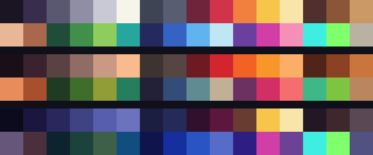

# Redesenho visual e mundo com contexto — design (Fase 0)

> **Status:** D1 (anos 80) e D2 (1280x720, texel de 2 px) aprovadas; Fase 1 implementada
> ([redesign-fase-1.md](redesign-fase-1.md)). D3 (manter os 21 tipos) e D6 (avenidas mais largas)
> decididas e a Fase 2 implementada ([redesign-fase-2.md](redesign-fase-2.md)). D7 segue como proposta e precisa de resposta antes
> da Fase 3.
> Lista de trabalho e status por item: [redesign-roteiro.md](redesign-roteiro.md).
> Tudo que está marcado como **Decisão** pode ser trocado antes da Fase 1 sem retrabalho.

## 1. Resumo das decisões

| # | Decisão | Proposta | Custo de mudar depois |
|---|---|---|---|
| D1 | Época da paródia | **Anos 80** (1986): neon, carros quadrados, espião de filme de ação | Baixo até a Fase 1; médio depois (carros, letreiros, nomes) |
| D2 | Resolução | **Manter 1280x720 e as unidades do mundo**; arte em pixel lógico de **2 px** | Baixo: é uma constante da fábrica de arte |
| D3 | Lista de prédios | **Decidido:** 21 tipos urbanos + 2 rurais, sem corte (cinema, academia e posto ficam) | Baixo: é uma tabela |
| D4 | Tamanho do mundo | Manter grade 12x12 e o campo; rios e litoral ficam para o marco 8 | Alto se entrar no meio |
| D5 | Duração do dia | 24 min reais (1 hora de jogo = 60 s), começando às 08:00 | Nenhum: é uma constante |
| D6 | Avenidas | **Decidido:** 2 avenidas reais (mais largas), cruzando no centro | Médio: mexe em calçadas e trânsito |
| D7 | Mecânicas novas que os serviços exigem | Ver seção 7.3 (banco, oficina, mercado) | — |

## 2. Estado atual (o que foi medido)

- Cidade com seed 2024: **182 prédios**, 11 parques, 116 árvores. 136 prédios têm pelo menos 160x160 px
  (hoje o mínimo para loja). Largura de 132 a 344 px; 37 prédios têm 280 px ou mais.
- Mundo: 13440 x 6720 px (cidade 6720 + campo 6720). O `gdd.md` e o `arquitetura.md` citavam
  12480x5760, valor antigo; corrigido nesta mudança.
- Todo o visual é `ColorRect` e `_draw` com retângulos e círculos. `world.gd` desenha o chão do mundo
  inteiro em um único `_draw`.
- Interior: uma sala de 1920x1200 com 10 móveis sorteados (4 nas lojas), sem tipo.
- 385 testes em 22 arquivos. 68 referências a constantes de layout em 10 arquivos de teste.
- Não existe save em disco: o estado vive no autoload `GameState` (ficha, inventário, prédio atual).
  "Manter os saves" significa manter esse contrato e os ids de prédio estáveis para a mesma seed.

## 3. Direção de arte

**Época (D1): anos 80.** Paródia de filme de espião de ação: terno, óculos escuros, gadgets absurdos,
vilões caricatos. Dá a melhor noite (neon, vitrines, letreiros) e combina com pixel art 8/16-bit.
A paleta abaixo serve às três épocas; o que muda com a época são carros, letreiros e nomes.

**Regras de desenho** (valem para todo sprite e tile):

1. Só cores da paleta. Nenhuma cor calculada (`darkened`, `from_hsv`) na arte.
2. Contorno de 1 texel na cor *tinta* (`#1a1423`) em tudo que se move ou é sólido. Chão não tem contorno.
3. Dois a três tons por material: sombra, base, luz. Luz sempre vem do **noroeste**.
4. Sombra projetada para o **sudeste**, cor *tinta* com 35% de opacidade, comprimento proporcional à altura.
5. Vista de cima com fachada sul visível (3/4), como nos jogos de referência. Personagens são mais altos
   que largos: a cabeça passa do topo da colisão.
6. Humor nos detalhes (nomes, letreiros, cartazes), nunca em texto que atrapalhe a leitura do jogo.

### 3.1 Paleta (32 cores)

Amostra gerada por código, sob a luz do dia, do entardecer e da noite: 

| # | Nome | Hex | Uso principal |
|---|---|---|---|
| 1 | tinta | `#1a1423` | contorno, sombra projetada |
| 2 | sombra | `#3a2e4d` | sombra de materiais escuros, telhado escuro |
| 3 | ardósia | `#5a5770` | telhado, metal escuro |
| 4 | cinza | `#8f8fa3` | calçada (sombra), concreto, metal |
| 5 | cinza claro | `#c9c9d6` | calçada, faixa de pedestre, metal claro |
| 6 | branco | `#f6f3e8` | luz máxima, texto, faixas |
| 7 | asfalto | `#3d4352` | asfalto |
| 8 | asfalto claro | `#555d6e` | granulado do asfalto, bueiro |
| 9 | vinho | `#6e2338` | sombra do vermelho, tijolo escuro |
| 10 | vermelho | `#d1344a` | tijolo, criminoso, alerta, lanterna de carro |
| 11 | laranja | `#f0803c` | telha, luz de poste, toldo |
| 12 | âmbar | `#f7c548` | faixa da rua, janela acesa, dinheiro |
| 13 | creme | `#f9e6a8` | parede clara, farol, luz de janela |
| 14 | marrom escuro | `#4f2f2a` | madeira (sombra), porta |
| 15 | marrom | `#8a5638` | madeira, terra, tronco |
| 16 | areia | `#c99a66` | estrada de terra, madeira clara, plantação |
| 17 | pele clara | `#e8b796` | pele |
| 18 | pele escura | `#a8684a` | pele, tijolo claro |
| 19 | verde escuro | `#1f4d3a` | sombra de copa, cerca viva |
| 20 | verde | `#3f8f4a` | grama, copa |
| 21 | verde-limão | `#8fce5a` | luz de copa, plantação nova |
| 22 | turquesa | `#26a69a` | farmácia, vidro, água rasa |
| 23 | azul-marinho | `#232b5c` | terno do agente, vidro à noite, sombra do azul |
| 24 | azul | `#3465c4` | água, viatura, jogador 1 |
| 25 | azul-céu | `#5fb4f0` | vidro de janela de dia, água (luz) |
| 26 | gelo | `#bfe6f5` | reflexo de vidro, para-brisa |
| 27 | roxo | `#6b3fa0` | vida noturna, toldo, sombra do rosa |
| 28 | magenta | `#d13fa6` | neon |
| 29 | rosa | `#f58fb8` | neon, flores, amanhecer |
| 30 | ciano neon | `#3ff0e0` | neon, gadgets, scanner |
| 31 | verde neon | `#7dff6a` | neon, cruz da farmácia, HUD positivo |
| 32 | concreto quente | `#b8b0a0` | piso de lote, parede de concreto |

**Rampas de dia** (sombra → base → luz):

| Material | Rampa |
|---|---|
| Asfalto | tinta → asfalto → asfalto claro |
| Calçada / concreto | ardósia → cinza → cinza claro |
| Tijolo | vinho → vermelho → pele escura |
| Parede clara | cinza → concreto quente → creme |
| Madeira | marrom escuro → marrom → areia |
| Telha | vinho → laranja → âmbar |
| Telhado de laje | sombra → ardósia → cinza |
| Vegetação | verde escuro → verde → verde-limão |
| Água | azul-marinho → azul → azul-céu |
| Vidro | azul-marinho → azul-céu → gelo |
| Metal | ardósia → cinza → branco |
| Pele | pele escura → pele clara (2 tons, dois conjuntos) |
| Terra | marrom → areia → creme |

**Rampa da noite.** A noite não troca as cores: o mundo inteiro é multiplicado pela cor ambiente
(seção 8) e as cores **emissivas** são desenhadas por cima, sem escurecer. São emissivas: âmbar e creme
(janelas, faróis), laranja (postes), vermelho (lanternas, semáforo), magenta, rosa, ciano neon e verde
neon (letreiros). A terceira faixa da imagem mostra o resultado.

### 3.2 Resolução e tamanho do pixel (D2)

**Proposta: opção A — manter tudo e desenhar com pixel lógico de 2 px.**

| | A. Manter 1280x720, texel = 2 px (proposta) | B. Baixar a base para 640x360 com escala inteira |
|---|---|---|
| Unidades do mundo | Iguais às de hoje | Iguais, com câmera em zoom 0,5 |
| Resolução de arte efetiva | 640x360 texels | 640x360 texels |
| Constantes de layout | **Nenhuma muda** | Nenhuma muda |
| Testes afetados | **Nenhum** | `test_aim_and_display` e os de UI (painéis medidos para 1280x720) |
| Interface | Texto nítido, painéis atuais continuam servindo | Inventário, ficha, loja e card precisam ser refeitos para 640x360 |
| Nitidez do pixel | Em janela de escala não inteira, alguns texels ficam com 1 px de diferença | Perfeita em qualquer janela |
| Mobile | Texto legível | Texto pequeno demais sem fonte pixel própria |

Motivos para A: todas as constantes de layout já são pares (560, 200, 140, 30, 360, 56, 12), então cabem
na grade de 2 px sem ajuste; os 385 testes não são tocados por esta decisão; e a UI existente continua
funcionando enquanto o mundo é redesenhado. Para reduzir a irregularidade de A:
`rendering/2d/snap/snap_2d_transforms_to_pixel` ligado e `DisplaySetup` escolhendo o tamanho de janela
mais próximo de uma escala inteira (1x, 1,5x, 2x). A opção B continua possível depois: a arte é a mesma.

Tamanhos resultantes (texels → px do mundo):

| Elemento | Texels | Mundo | Colisão |
|---|---|---|---|
| Personagem | 12 x 16 | 24 x 32 | 24x24 (jogador) e raio 11 (NPC), sem mudança |
| Carro | 26 x 13 | 52 x 26 | 52x26, sem mudança |
| Tile de chão | 16 x 16 | 32 x 32 | — |
| Porta | 28 x 6 (+ batente na fachada) | 56 x 12 | sem mudança |
| Copa de árvore | 32 x 32 | 64 x 64 | tronco 24x24, sem mudança |

Câmera: zoom 1,0 (como hoje). Reavaliar com as capturas da Fase 1; é uma constante.

### 3.3 Como a arte é produzida por código

Pasta nova `scripts/art/`, toda em lógica pura (`RefCounted`), testável sem cena:

| Arquivo | Papel |
|---|---|
| `palette.gd` | As 32 cores por nome e as rampas por material |
| `pixel_canvas.gd` | Envelope de `Image`: retângulo, linha, contorno automático, sombra, espelhar, girar em passos, e `stamp(linhas, legenda)` que desenha um sprite a partir de texto |
| `sprite_defs_*.gd` | Os sprites como texto (uma letra por texel) + legenda letra → cor da paleta |
| `tile_factory.gd` | Tiles de chão repetíveis por material (asfalto, calçada, grama, terra, pisos de interior), com ruído por seed |
| `sprite_factory.gd` | Monta e **guarda em cache** `ImageTexture` por chave (`"car/sedan/red/dir3"`). Cada textura é gerada uma única vez |
| `pixel_font.gd` | Fonte 5x9 própria (A–Z, 0–9, acentos do português, pontuação) para letreiros e HUD |

Sprites como texto são fáceis de revisar, de recolorir (troca-se a legenda: mesma camisa em 8 cores) e de
testar (toda letra tem legenda, toda cor está na paleta, todo sprite tem o tamanho declarado).

**Desenho no mundo sem custo por frame:**

- O chão deixa de ser um `_draw` único. Vira um nó por quarteirão (`block_chunk.gd`, 560x560 px), que
  desenha ruas, calçadas, lote e mobiliário não sólido com `draw_texture_rect` em modo repetido.
  O Godot guarda os comandos de desenho e descarta os nós fora da tela; nada é redesenhado por frame.
- Cada prédio é um nó (`building_view.gd`) com sombra, telhado, fachada, porta, toldo e letreiro.
- Personagens e carros usam `Sprite2D` com texturas do cache. Animação troca a textura, sem `_draw`.
- Carros giram livremente na física, mas o sprite usa **16 direções pré-geradas** (rotação feita uma vez
  no `PixelCanvas`), para não serrilhar. A colisão continua usando o ângulo real.
- Nenhuma textura passa de 256x256 texels; não há atlas gigante do mundo (estouraria a memória no browser).

**Camadas (z):** chão 0 · marcas e sombras 1 · itens 2 · prédios 3 · personagens e carros 4 ·
copas, toldos e letreiros 5 · camada de luz (seção 8) acima de tudo.

### 3.4 Personagens e carros

- **Personagem:** 4 direções (esquerda é o espelho da direita), parado + 2 quadros de passo. O corpo olha
  para a direção dominante da mira; a arma é um sprite pequeno girado no ângulo exato.
- **Distinção sem depender de cor:**

| Quem | Silhueta | Marca extra |
|---|---|---|
| Jogador | Terno, gravata, óculos escuros | Anel no chão (J1 azul, J2 laranja) |
| Inocente | Roupas e cabelos variados (8 cores de roupa, 4 cabelos, 2 peles) | Nenhuma |
| Criminoso | Gorro, máscara, ombros largos | "!" sobre a cabeça ao mirar no jogador |
| Funcionário (interiores) | Uniforme do tipo de prédio (avental, jaleco, farda) | — |

- **Carros:** 7 modelos na mesma caixa de colisão 52x26: sedã, hatch, picape, van, táxi, viatura e o
  esportivo da agência. 8 cores. Faróis e lanternas são texels emissivos.

## 4. Fase 1 — mundo externo

| Elemento | Especificação |
|---|---|
| Asfalto | Tile 16x16 com granulado em 2 tons; remendos e bueiros por seed (1 bueiro a cada 2 trechos) |
| Faixa central | Tracejada âmbar nas ruas; dupla contínua nas avenidas |
| Faixa de pedestre | Nos 4 lados de cada cruzamento (já existe na lógica de calçadas) |
| Meio-fio | 1 texel claro + 1 texel de sombra entre asfalto e calçada |
| Calçada | Piso de placas 8x8 texels, com juntas; rebaixo em frente a cada porta |
| Lote | Concreto quente; quintais com grama |
| Prédio | Telhado (laje, telha ou zinco conforme o bairro) + faixa de fachada no sul do retângulo |
| Fachada | Altura = 12 px por andar + 12 (1 andar = 24 px, 6 andares = 84 px), sempre **dentro** do retângulo de colisão |
| Detalhes de telhado | Caixa d'água, ar condicionado, claraboia, antena, chaminé (usa o campo `roof` que já existe) |
| Sombra do prédio | Faixa a leste e ao sul, 6 px por andar, sem passar do meio-fio |
| Parque | Caminhos de terra em cruz ou diagonal, lago (30% dos parques), canteiros, bancos |
| Campo | Grama com tufos, plantações com fileiras em 2 tons, cercas ao redor, celeiros com telhado de telha, estrada de terra com marcas de roda |

**Mobiliário urbano.** Calçada tem 30 px e os pedestres andam pelo meio dela, então:

- Tudo que fica **na calçada** é não sólido e fica na faixa de 8 px junto ao meio-fio: poste (2 por
  trecho), semáforo (4 por cruzamento), hidrante, lixeira, placa de rua, ponto de ônibus, banca.
- Tudo que é **sólido** fica dentro de lotes e parques: árvores, bancos de praça, cercas.
- Posições geradas por seed em `street_props_layout.gd` (lógica pura). Teste: nenhum objeto sólido
  encosta na linha de caminhada das calçadas.

**HUD:** moldura retrô (borda de 2 texels, cantos chanfrados), fonte pixel própria nos rótulos do HUD e
nos letreiros do mundo. Os painéis (inventário, ficha, loja, card) ganham a moldura na Fase 1 e a
fonte pixel na Fase 5.

**Ajuste de ordem proposto:** o roteiro pede relógio, bairro e rua no HUD já na Fase 1, mas o relógio
nasce na Fase 4 e os bairros na Fase 2. A Fase 1 entrega o HUD novo com os três espaços reservados; o
nome do bairro e da rua entra na Fase 2 e o relógio na Fase 4.

## 5. Fase 2 — cidade com contexto

### 5.1 Avenidas (D6, decidido: mais largas de verdade)

Duas avenidas, nas linhas 6 (vertical e horizontal), cruzando no centro. A horizontal continua na
estrada do campo (`ROAD_Y = 3360`), virando a ligação natural entre as regiões.

| | Rua | Avenida |
|---|---|---|
| Asfalto | 140 px | 180 px |
| Calçada | 30 px cada | 30 px cada |
| Corredor | 200 px | 240 px |
| Faixas | 1 por sentido (centro a 26 px do eixo) | 2 por sentido (28 e 66 px) + canteiro pintado |
| Lotes vizinhos | 360 px | 340 px no eixo que encosta na avenida |

### 5.2 Bairros

Seis bairros por seed. O Centro nasce nas 4 quadras do meio; os outros cinco recebem um ponto inicial
em setores ao redor, embaralhados pela seed; cada lote vai para o ponto mais próximo. Se algum bairro
ficar com menos de 10 lotes, a geração repete com a seed derivada seguinte (determinístico).

| Bairro | Lotes (alvo) | Parques | Formato dos lotes (único / dois / com quintal) | Andares | Telhado | Paredes |
|---|---|---|---|---|---|---|
| Centro comercial | 22% (~32) | 5% | 45 / 50 / 5 | 3–6 | laje | concreto quente, cinza claro, azul, vinho |
| Residencial | 28% (~40) | 15% | 10 / 40 / 50 | 1–2 | telha | creme, pele escura, turquesa, rosa |
| Vida noturna | 12% (~17) | 5% | 30 / 65 / 5 | 2–3 | laje | roxo, azul-marinho, vinho, ardósia |
| Industrial | 16% (~23) | 0% | 75 / 20 / 5 | 1–2 | zinco | cinza, ardósia, marrom, concreto quente |
| Bairro nobre | 14% (~20) | 20% | 15 / 15 / 70 | 1–3 | telha | branco, creme, gelo, areia |
| Cívico | 8% (~12) | 10% | 70 / 25 / 5 | 2–4 | laje | cinza claro, branco, concreto quente |

**Nomes** (sorteados por seed, de listas próprias):

- Bairros: Centro Velho, Vila Sossego, Baixo Neon, Distrito das Chaminés, Jardim Grã-Fino, Praça dos Três Carimbos.
- Ruas e avenidas (26 linhas): Av. Codinome, Av. Martini Batido, Rua do Disfarce, Rua da Escuta, Travessa
  do Microfilme, Rua Sem Saída (tem saída), Rua do Álibi, Rua Agente Duplo, Beco do Informante…
- Prédios: prefixo do tipo + sorteio de uma lista com humor por tipo. Exemplos: Hotel Álibi, Cantina Bela
  Máfia, Bar Sem Testemunhas, Boate Infravermelho, Banco Confia em Mim, Oficina Pneu Furado, Cine Suspense,
  Academia Braço Longo da Lei, Edifício Codinome.

### 5.3 Tipos de prédio (`scripts/world/building_defs.gd`)

Colunas da tabela no código: `id`, `name`, `districts`, `min`, `max`, `min_size`, `facade`, `sign`,
`interior`, `staff`, `hours`, `service`, `shop`. Quantidades para a cidade de ~180 prédios:

| id | Nome | Bairros | Mín–máx | Tamanho mín. | Letreiro | Horário | Serviço |
|---|---|---|---|---|---|---|---|
| `hq` | QG (disfarçado de **lavanderia**) | Centro | 1–1 | 160 | ciano, discreto | 24 h | Briefing e baú de equipamento |
| `police` | Delegacia | Cívico | 1–2 | 280 | azul | 24 h | Entregar criminoso atordoado |
| `hospital` | Hospital | Cívico | 1–1 | 280 | cruz vermelha | 24 h | Cura total paga |
| `bank` | Banco | Centro, Nobre | 2–3 | 200 | âmbar | 09–17 | Guardar e sacar dinheiro |
| `hotel` | Hotel | Centro, Noturna, Nobre | 2–4 | 240 | magenta neon | 24 h | Dormir |
| `restaurant` | Restaurante | Centro, Nobre, Noturna | 4–6 | 160 | laranja | 11–23 | Refeição |
| `diner` | Lanchonete | Centro, Residencial, Industrial | 4–6 | 160 | vermelho | 06–22 | Lanche |
| `bar` | Bar | Noturna, Centro, Industrial | 4–6 | 160 | verde neon | 17–03 | Rumores |
| `club` | Boate | Noturna | 2–3 | 240 | magenta + ciano piscando | 21–05 | Informante |
| `agent_store` | Loja do Agente | Centro, Cívico | 2–2 | 160 | ciano | 08–20 | Loja (estoque atual) |
| `armory` | Armaria | Industrial, Centro | 2–2 | 160 | vermelho | 08–20 | Loja (estoque atual) |
| `pharmacy` | Farmácia | Residencial, Centro, Cívico | 3–3 | 160 | cruz verde neon | 07–23 | Loja (estoque atual) |
| `market` | Mercado | Residencial, Centro | 3–5 | 200 | âmbar | 07–22 | Loja de comida para levar |
| `workshop` | Oficina | Industrial, Residencial | 2–3 | 200 | laranja | 07–19 | Pintar (e consertar) o carro |
| `gas_station` | Posto | Industrial, Residencial, Centro | 2–3 | 200 | vermelho + branco | 24 h | Conveniência 24 h |
| `cinema` | Cinema | Centro, Noturna | 1–2 | 240 | marquise com lâmpadas | 13–24 | Sessão |
| `gym` | Academia | Residencial, Nobre, Centro | 2–3 | 160 | azul | 06–22 | Treino |
| `office` | Escritório | Centro, Cívico | preenche | 132 | placa pequena | 08–18 | Local de trabalho de NPCs |
| `apartment` | Prédio residencial | Residencial, Centro, Noturna, Nobre | preenche | 132 | nome do edifício | 24 h | Moradia de NPCs |
| `house` | Casa | Residencial, Nobre | preenche | 132 | número | 24 h | Moradia de NPCs |
| `warehouse` | Armazém | Industrial | preenche | 200 | placa pintada | 24 h | Ponto de crimes (contrabando, tráfico) |
| `farm` | Casa de fazenda | Campo | 6 | — | — | 24 h | Moradia de NPCs do campo |
| `farm_store` | Armazém Rural | Campo | 1 | — | madeira | 06–20 | Loja (estoque atual) |

Somando: 38 a 55 prédios com serviço (21% a 30% da cidade); o resto é preenchido por peso do bairro.
Dá, em média, um lugar útil a cada quarteirão ou dois.

**Atribuição** (determinística): depois de gerar os retângulos, (1) cada tipo com mínimo recebe seus
prédios, na ordem da tabela, sorteando entre os que cabem no tamanho e estão em um bairro permitido;
(2) sorteia-se quantos extras até o máximo; (3) o resto é preenchido pelos pesos do bairro. Se um
bairro não tiver prédio que caiba, o tipo pode cair em outro bairro: o mínimo sempre é cumprido.

**Fora da lista:** Prefeitura. Aparece na descrição do bairro cívico, mas não tem serviço definido e
entraria como enfeite. Fica como fachada especial de um `office` do bairro cívico.

**Sem corte (D3, decidido):** `cinema`, `gym` e `gas_station` ficam na lista. Eram candidatos a corte
por terem o serviço mais fraco (seção 7.2); com a decisão, a Fase 3 precisa dar a cada um o interior
e o serviço previstos (sessão de cinema, treino, conveniência 24 h).

### 5.4 NPCs ligados ao mundo

Novo `scripts/npc/population.gd` (lógica pura): para cada seed de NPC, sorteia um prédio de trabalho
(entre os que têm `staff`) e uma moradia (`apartment`, `house`, `farm`). `NpcIdentity.generate`
mantém a assinatura atual e ganha um terceiro parâmetro opcional com esse contexto. Campos novos:
`work_id`, `work_name`, `role`, `home_id`, `home_name`, `district`.

- "O que você faz da vida?" → "Sou garçonete na Cantina Bela Máfia há 4 anos."
- "Fale um pouco sobre você." → "…moro no Edifício Codinome, na Vila Sossego, há 12 anos."
- Sem contexto (testes antigos, NPC avulso), vale a lista `JOBS` atual. Os 3 testes que usam `JOBS` continuam válidos.

### 5.5 Crimes por bairro e por prédio

`CrimeProfiles` ganha, por tipo de crime, `near` (tipos de prédio), `districts` (multiplicador de peso)
e `night` (multiplicador à noite). O `IncidentManager` procura um prédio compatível perto do jogador
para posicionar o crime. Os 6 tipos atuais ficam; entram 3:

| id | Nome | Perto de | Criminosos | Recompensa | Noite |
|---|---|---|---|---|---|
| `assault` (atual) | Assalto armado | banco, mercado, posto | 1 | 100 | x1,5 |
| `gang_fight` (atual) | Briga de gangues | armazém, bar | 3 | 200 | x2 |
| `trafficking` (atual) | Tráfico de drogas | armazém, boate | 2 | 150 | x2 |
| `bank_heist` (novo) | Assalto a banco | banco (só aberto) | 3 | 260 | x0 |
| `bar_brawl` (novo) | Briga de bar | bar, boate | 2 | 120 | x3 |
| `break_in` (novo) | Arrombamento | casa, prédio residencial | 1 | 110 | x3 |

## 6. Mudanças por arquivo

| Arquivo | Muda | Preservado |
|---|---|---|
| `city_layout.gd` | Largura por linha (`corridor(axis, i)`), lotes com tamanho por posição, bairros, sorteio do formato do lote por bairro, campos novos no prédio (`type`, `name`, `district`, `floors`, `wall`, `roof_kind`), `SHOP_PLAN` sai (vira cota em `BuildingDefs`) | `CELLS`, `BLOCK`, `ASPHALT`, `SIDEWALK`, `ROAD`, `LOT` (como valores da rua comum), porta na borda sul, `exit_spawn`, ids em sequência, `building_at`, `building_by_id`, campo `shop`, campo `color` (agora vindo da paleta), `roof`, determinismo |
| `sidewalk_graph.gd` | `half()` passa a depender da linha | Estrutura do grafo e todas as funções |
| `traffic_route.gd` | Deslocamento de faixa por linha; avenida com 2 faixas | Nós, escolhas e regra da faixa da direita |
| `country_layout.gd` | Tipos `farm`/`farm_store` e nomes; cercas e celeiros como dados | Estrada, 7 fazendas, plantações, árvores, ids a partir de 1000 |
| `world_layout.gd` | Chama `Population`; expõe `district_at`, `street_name_at`, `nearest_building_of` | Regiões, NPCs, itens, trânsito, `is_blocked`, `free_point_near` |
| `world.gd` | Sai o `_draw` único e os `ColorRect`; cria `BlockChunk`, `BuildingView`, camada de luz; atualiza bairro e rua do jogador | Criação de colisões, portas, carros, NPCs, itens, paredes do mundo, `IncidentManager` |
| `interior_layout.gd` | Passa a ser paramétrico: `new(id, tipo, tamanho_da_fachada)`; tamanho, cômodos, paredes, móveis com tipo, vagas de NPC e zonas; funções hoje estáticas viram de instância | Seed por id do prédio, zona livre na saída, porta de saída no sul, balcão e zona de compra das lojas |
| `interior.gd` | Monta cômodos, paredes internas, móveis com sprite, NPCs e zonas de serviço | Jogador, limites da câmera, porta de saída, fluxo de loja |
| `game_state.gd` | Guarda `building_type` junto de `building_shop` | Todo o contrato atual |
| `npc_identity.gd` | Contexto opcional de trabalho e moradia | `generate(seed, kind)`, perguntas, traços, humor |
| `crime_profiles.gd` | Campos `near`, `districts`, `night`; 3 tipos novos | Perfis por região, `pick`, textos de alerta |
| `player.gd`, `npc.gd`, `car.gd`, `pickup.gd`, `bullet.gd` | `_draw` troca por sprites do cache | Toda a lógica |
| `hud.gd` | Visual novo, campos de bairro, rua e relógio | Todas as funções `*_text()` usadas nos testes |

**Arquivos novos:** `scripts/art/*` (seção 3.3), `world/building_defs.gd`, `world/district_layout.gd`,
`world/name_generator.gd`, `world/street_props_layout.gd`, `world/block_chunk.gd`,
`world/building_view.gd`, `world/day_cycle.gd`, `world/light_layer.gd`, `autoload/world_clock.gd`,
`interior/interior_templates.gd`, `interior/services.gd`, `npc/population.gd`, `tools/capture.gd`,
`tools/perf_probe.gd`.

### 6.1 Impacto nos testes existentes

| Mudança | Testes que precisam de atualização | Motivo |
|---|---|---|
| Resolução (opção A) | Nenhum | Unidades e viewport iguais |
| Arte por sprites (Fase 1) | Nenhum previsto | Testes não leem `_draw` |
| Avenidas (Fase 2) | `test_city_layout` (3: tamanho do lote, espaço entre lotes, carro estacionado), `test_sidewalks` e `test_traffic` (os que fixam o meio da calçada e a faixa) | Largura deixa de ser única |
| Bairros e tipos (Fase 2) | `test_city_layout` (2 de lojas, 1 de seed diferente que compara `color`), `test_pickups_and_shops` (onde lê `SHOP_PLAN`) | Cotas mudam de lugar; cor vem de paleta pequena |
| Interiores (Fase 3) | `test_interior_layout` (os 8), partes de `test_scenes` e `test_pickups_and_shops` | `SIZE`, `COUNTER` e funções estáticas viram de instância |
| NPCs (Fase 2) | Nenhum (contexto é opcional) | — |

Estimativa: cerca de 25 dos 385 testes reescritos, todos por mudança intencional, cada um explicado no
changelog da fase. Nenhum teste é apagado sem substituto.

## 7. Fase 3 — interiores

### 7.1 Tamanho e planta

Três tamanhos, sempre maiores que a fachada: **P** 1280x800, **M** 1920x1200 (o de hoje), **G** 2560x1440.
O tipo define o tamanho base; fachada com menos de 180 px de largura desce um degrau e com 280 px ou
mais sobe um.

Cada modelo gera, por seed do id do prédio: cômodos (retângulo + piso), paredes internas com vãos de
porta, móveis (`tipo`, retângulo, sólido ou não), vagas de NPC (`papel`, posição) e zonas de serviço
(`id`, retângulo, verbo). Variação por seed: espelhamento horizontal, número de mesas/quartos/prateleiras
e posição do balcão. **Validação:** preenchimento em grade de 32 px a partir da entrada precisa alcançar
a saída e todas as zonas.

| Modelo | Usado por | Base | Planta | Móveis reconhecíveis | NPCs |
|---|---|---|---|---|---|
| Loja | armaria, farmácia, loja do agente, mercado, posto, armazém rural | P | Salão + depósito ao fundo | Balcão, caixa, prateleiras em fileiras, vitrine | Vendedor, 0–2 clientes |
| Hotel | hotel | G | Saguão ao sul, corredor, 4–6 quartos | Recepção, sofás, camas, criados-mudos | Recepcionista, 1–3 hóspedes |
| Restaurante | restaurante, lanchonete | M / P | Salão + cozinha ao norte | Mesas com cadeiras, fogão, balcão de passagem | Garçom, cozinheiro, 2–5 clientes |
| Bar | bar | M | Salão único | Balcão comprido com banquetas, mesas, sinuca, jukebox | Barman, 2–5 clientes |
| Boate | boate | G | Pista, bar, camarote | Pista de luzes (piso animado), caixas de som, cabine do DJ | DJ, barman, segurança, 4–8 clientes |
| Banco | banco | M | Salão, guichês, cofre ao fundo | Guichês com vidro, fila, porta do cofre | 2 caixas, segurança, 1–3 clientes |
| Delegacia | delegacia | G | Recepção, sala dos agentes, celas | Balcão, mesas, grades, quadro de procurados | Atendente, 2 policiais |
| Hospital | hospital | G | Recepção, enfermaria, consultório | Macas, biombos, armário de remédios | Recepcionista, médico, 1–3 pacientes |
| Oficina | oficina | M | Baia única | Elevador com carro, bancada, pneus, ferramentas | Mecânico |
| Cinema | cinema | G | Bilheteria + sala | Poltronas em fileiras, tela, pipoqueira | Bilheteiro, 2–6 espectadores |
| Academia | academia | M | Salão + vestiário | Halteres, esteiras, ringue | Instrutor, 1–4 alunos |
| Escritório | escritório | M | Recepção + baias + sala do chefe | Mesas, computadores, arquivo, bebedouro | 2–5 funcionários |
| Moradia | prédio residencial, casa, casa de fazenda | P | Sala, cozinha, quarto | Sofá, TV, mesa, cama, fogão | 0–2 moradores (os do `Population`) |
| Armazém | armazém | G | Galpão | Caixas empilhadas, paletes, empilhadeira | 0–2 trabalhadores |
| QG | QG | G | Lavanderia na frente; sala secreta atrás de uma máquina | Máquinas de lavar, mesa de briefing, telão, baú | Atendente (agente disfarçado), chefe |

### 7.2 Serviços (`scripts/interior/services.gd`)

Lógica pura no formato do `ShopDefs.buy`: recebe ficha, inventário e relógio, devolve um código de
resultado. Toda interação passa por `InteractZone` e `p{N}_interact`, com o verbo no HUD.

| Prédio | Interação | Custo | Efeito |
|---|---|---|---|
| Hotel | Dormir | $40 | Vida cheia; relógio avança para 07:00 |
| Restaurante | Refeição | $25 | +6 de vida |
| Lanchonete | Lanche | $10 | +3 de vida |
| Bar | Pagar uma rodada | $15 | Revela no HUD o crime ativo mais próximo ou a posição de um criminoso solto |
| Boate | Falar com o informante | $50 | Marca todos os criminosos do bairro por 60 s |
| Hospital | Atendimento | $5 por ponto de vida que falta | Vida cheia |
| Delegacia | Entregar preso | — | Cada criminoso atordoado desde a última visita rende +40 pontos e $30 |
| Banco | Depositar / sacar | — | Dinheiro guardado fica protegido (ver 7.3) |
| QG | Briefing | — | Mostra os crimes ativos e a contagem do dia |
| QG | Baú | — | Guarda e retira itens do inventário |
| Oficina | Pintar o carro | $30 | Troca a cor do carro em que o jogador chegou |
| Mercado | Loja | preços próprios | Vende comida para levar |
| Posto | Loja | preços 50% maiores | Kit médico e comida a qualquer hora |
| Cinema | Sessão | $20 | Avança 2 h; +25% de XP por 5 min |
| Academia | Treino (1 vez por dia) | $30 | +20 de XP |
| Lojas atuais | Comprar e vender | como hoje | Como hoje |
| Moradia, escritório, armazém | Conversar com quem está lá | — | Card de personalidade, já ligado ao lugar |

### 7.3 Mecânicas novas que alguns serviços exigem (D7)

Sem elas, o serviço seria enfeite. Preciso do seu sim ou não para cada uma:

| Serviço | Depende de | Proposta | Se a resposta for não |
|---|---|---|---|
| Banco | Hoje nada faz o jogador perder dinheiro | Ao ser derrotado, o agente perde metade do dinheiro que carrega; o do banco fica | Banco vira só local de crime (`bank_heist`), sem interação |
| Delegacia | Hoje atordoar já pontua na hora | Contador de "presos a entregar" na ficha; a entrega paga o bônus | Delegacia fica sem interação própria (só conversa com os policiais) |
| Oficina | Carro não tem dano | Só pintura agora; conserto entra junto com o dano de veículos | — |
| Mercado e posto | Não existe item de comida | Item novo `snack` (cura 3, empilha até 5, $12) em `item_defs.gd` | Vendem só kit médico |
| Bar e boate | Não existe marcador de alvo | Seta na borda do HUD apontando o alvo revelado | Rumor vira só texto com direção e distância |

## 8. Fase 4 — dia e noite

**Relógio.** Lógica pura em `world/day_cycle.gd`; o autoload `WorldClock` só acumula o tempo e emite
sinais de troca de hora e de fase. Vive entre trocas de cena, é zerado junto com `reset_players()` nos
testes e, no multiplayer, o anfitrião envia o minuto atual.

- 1 dia = 24 min reais (`DAY_SECONDS = 1440`); 1 hora de jogo = 60 s. Início às 08:00.
- Fases: madrugada 00–05, amanhecer 05–08, dia 08–17, entardecer 17–19:30, noite 19:30–24.

**Cor ambiente** (um `CanvasModulate` no mundo externo; interpolação linear entre as chaves):

| Hora | Cor | Luminância |
|---|---|---|
| 00:00 – 05:00 | `#7078d0` (azul-violeta) | 0,49 |
| 06:15 | `#f2b3c7` (rosa) | 0,76 |
| 08:00 – 17:00 | `#ffffff` | 1,00 |
| 18:30 | `#ffc49a` (laranja) | 0,81 |
| 19:30 | `#9e73cc` (roxo) | 0,51 |
| 21:00 | `#7078d0` | 0,49 |

**Piso de luminosidade:** a cor ambiente nunca fica abaixo de **0,45** de luminância nem com qualquer
canal abaixo de 0,40. Um teste percorre o dia inteiro, minuto a minuto, conferindo isso. A noite é azul
e roxa saturada: as cores do mundo continuam distinguíveis, como mostra a terceira faixa da imagem da paleta.

**Luzes.** O `CanvasModulate` escurece tudo que está na mesma camada, inclusive um brilho. Por isso as
luzes ficam em uma `CanvasLayer` própria com `follow_viewport_enabled`, que acompanha a câmera e não é
tingida. Nela entram sprites com mistura aditiva (barato, funciona no GL Compatibility e no browser).
`Light2D` não entra no plano; só seria avaliado se o brilho aditivo não bastasse.

| Luz | Acende | Apaga | Detalhe |
|---|---|---|---|
| Poste | 18:00 | 06:30 | Poça de luz laranja de 96 px na calçada |
| Janelas | 18:00 em diante | conforme o tipo | Por seed, 40–70% acesas; moradias apagam entre 23:00 e 06:00; escritórios às 20:00 |
| Letreiro e neon | Ao abrir (ou 18:00) | Ao fechar | Cor da tabela de tipos; boate pisca |
| Vitrine | Com o prédio aberto à noite | Ao fechar | Faixa de luz na calçada em frente |
| Faróis e lanternas | 18:00 | 06:30 | Cone curto à frente; lanterna vermelha |
| Semáforo | Sempre | — | Emissivo o dia todo |
| Jogador | 19:30 | 06:00 | Halo fraco no chão, para nunca se perder de vista |

**Interiores** não têm `CanvasModulate`: ficam sempre claros. As janelas internas mostram a cor do céu
da hora atual.

**Efeito no mundo:**

| Sistema | De dia | À noite (19:30–05:00) |
|---|---|---|
| Prédios | Abrem conforme a tabela | Fechado: porta mostra "Fechado — abre às HH:00" no HUD e não entra |
| Pedestres na cidade | 110 | 60 até 23:00; 25 de madrugada (os outros "vão para casa": somem ao chegar a uma porta de moradia) |
| Intervalo entre crimes (cidade) | 25 s | 16 s |
| Tipos de crime | Pesos normais | Multiplicadores da seção 5.5 |
| Trânsito | 10 carros | 6 carros, todos com farol |

## 9. Fase 5 — acabamento

| Item | Especificação |
|---|---|
| Tiro | Clarão de 2 quadros na ponta da arma; cápsula que cai e some em 2 s |
| Impacto | 4–6 faíscas em parede; poeira em chão |
| Carro | Poeira na terra; marcas de pneu em freada e curva forte (até 200 marcas, as mais antigas somem) |
| Câmera | Tremor de 2–4 px por 0,15 s em tiro de escopeta, colisão e dano |
| Portas | Fechamento em íris de 0,25 s ao entrar e sair |
| Mapa | Tecla de mapa: bairros coloridos, ruas com nome, ícone por tipo de prédio já visitado ou revelado; minimapa no canto com 1 quarteirão e meio de raio |
| Título e pausa | Tela de título com a cidade à noite ao fundo; pausa com mapa e controles |
| Limpeza | Busca por `ColorRect` e por cores fora da paleta nos scripts de cena; teste automático que falha se sobrar |

## 10. Desempenho e capturas

- `tools/perf_probe.gd`: roda a cena principal com vsync desligado por 10 s em 3 pontos fixos (centro,
  borda cidade/campo, campo), registrando tempo médio de quadro, chamadas de desenho e número de nós.
  Rodado **antes e depois** de cada fase; os números vão para o changelog da fase.
- A linha de base (antes de qualquer mudança) é medida no primeiro passo da Fase 1.
- Meta: não piorar mais de 20% o tempo de quadro em relação à linha de base em nenhuma fase, e manter
  60 fps no export web em máquina comum (verificado no fim das Fases 1 e 4).
- `tools/capture.gd`: abre o jogo de verdade, posiciona a câmera em pontos fixos, define a hora e salva
  PNGs em `docs/img/`. A pasta tem `.gdignore` para o Godot não importar as imagens.

## 11. Testes novos por fase

| Fase | Arquivo | Cobre |
|---|---|---|
| 1 | `test_palette.gd`, `test_pixel_canvas.gd`, `test_sprite_defs.gd` | 32 cores únicas; contorno e sombra; todo sprite com tamanho certo e só cores da paleta; cache devolve a mesma textura |
| 1 | `test_street_props.gd` | Determinismo; nada sólido na linha de caminhada; nada em cima de porta ou de `exit_spawn` |
| 1 | `test_scenes.gd` (acréscimos) | Mundo, jogador, NPC e carro sobem com sprites; nenhum `ColorRect` no mundo |
| 2 | `test_districts.gd` | Todo lote tem bairro; bairros contíguos; mínimo de lotes; determinismo |
| 2 | `test_building_defs.gd` | Mínimos e máximos respeitados; tamanho mínimo; todo prédio com tipo, nome e porta alcançável pela calçada; lojas vendem o mesmo de hoje |
| 2 | `test_names.gd`, `test_population.gd` | Nomes determinísticos e não vazios; todo NPC com trabalho e moradia existentes; respostas citam o lugar |
| 2 | `test_crime.gd` (acréscimos) | Crime aparece perto de prédio compatível; perfis por região intactos |
| 3 | `test_interior_templates.gd` | Para todo tipo e 20 ids: determinismo, móveis dentro da sala, sem sobreposição, saída e zonas alcançáveis |
| 3 | `test_services.gd` | Cada serviço: custo, efeito, falta de dinheiro; só dispara pela ação de input com o jogador na zona |
| 4 | `test_day_cycle.gd` | Avanço, fases, horários (inclusive os que viram a meia-noite), piso de luminosidade no dia inteiro |
| 4 | `test_lights.gd` | Cada luz acende e apaga na hora da tabela; interiores não escurecem |
| 5 | `test_effects.gd`, `test_map.gd` | Limite de marcas de pneu; mapa lista bairros e tipos |

## 12. Decisões do autor

| # | Pergunta | Resposta |
|---|---|---|
| D1 | Época | Anos 80 |
| D2 | Resolução | Opção A: manter 1280x720, texel de 2 px |
| D3 | Cortar `cinema`, `gym` e `gas_station`? | Não: os três ficam |
| D4 | Tamanho do mundo | Sem resposta; vale a proposta (grade 12x12 e campo) |
| D5 | Duração do dia | Sem resposta; vale a proposta (24 min) |
| D6 | Avenidas | Mais largas de verdade |
| D7 | Mecânicas novas da seção 7.3 | **Em aberto.** Sim ou não para cada uma, antes da Fase 3 |
